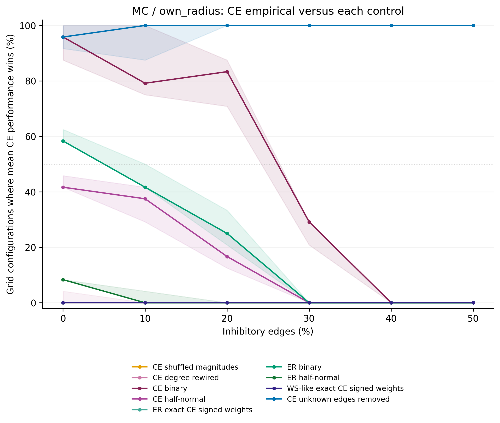
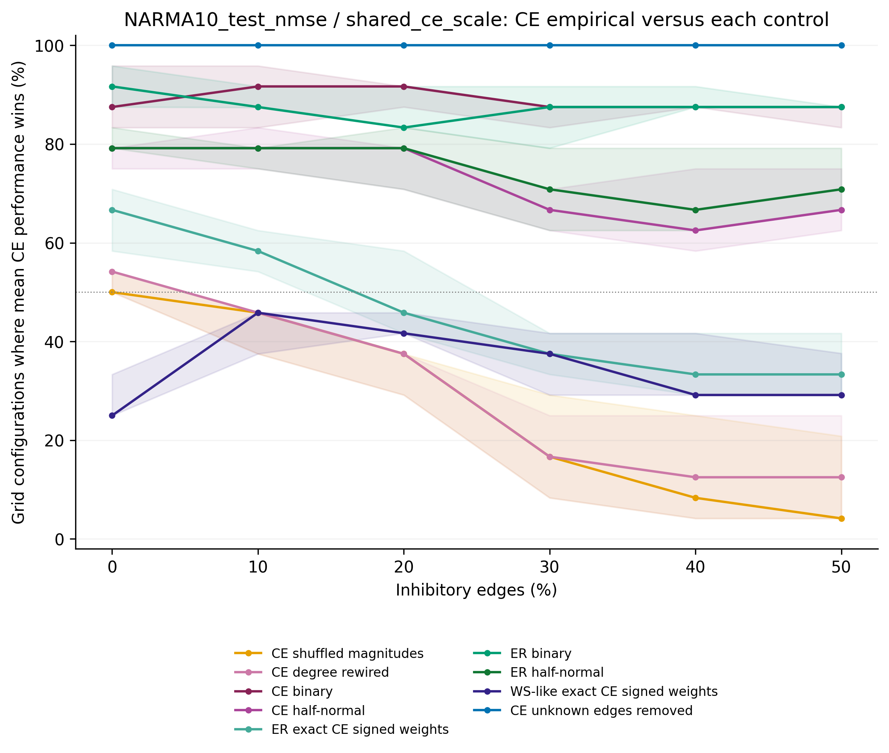

# How broadly does CE win across hyperparameters as E/I balance changes?

**Run:** `architecture_mc_narma_271846`. Ten models; 100 paired realizations; 24 hyperparameter settings; inhibitory-edge fractions 0%, 10%, 20%, 30%, 40%, 50%; three normalization protocols.

## Main result: breadth of matched-setting wins

The primary outcome is **how many identical hyperparameter settings favor CE at each inhibitory-edge fraction**, and how that count changes across the E/I sweep. Average performance across hyperparameters is supporting context, not the definition of winning.

The controls show that the breadth of CE's advantage depends strongly on the comparator, task and normalization:

- **Against binary ER**, own-radius and fixed-reference scaling give CE more wins at low inhibition and fewer toward 30–50%. With a shared CE multiplier, CE instead wins most settings across the entire sampled sweep.
- **Against exact-weight ER**, CE wins no MC settings under own-radius scaling, but retains a minority under shared scaling. NARMA wins remain more widespread: under shared scaling CE wins 16/24 settings at 0%, 14/24 at 10%, 11/24 at 20%, and 8/24 at both 40% and 50%.
- **Against magnitude-shuffled and degree-rewired CE**, empirical CE usually wins few MC settings. NARMA is more conditional: with shared scaling at 0%, empirical CE wins 12/24 settings against shuffled CE and 13/24 against rewired CE, despite having worse grid-averaged NARMA error. Those wins become less frequent as inhibition increases.

A lower average score therefore does not erase the regions where CE wins. Conversely, a broad win count does not tell us whether the gains are large or computationally useful.

## 1. Exactly what a hyperparameter duel means

Each duel compares CE and one control at the **same** radius-target setting, leak, input scale, inhibitory fraction and normalization protocol. Bias is fixed at zero. There are 3 radii × 2 leaks × 4 input scales = 24 duels per fraction and control.

First average the score over the 100 paired realizations **within each hyperparameter setting**. Then count how many of the 24 settings favor CE:

\[
W(f)=\frac{1}{24}\sum_{\theta\in\Theta}
\mathbf{1}\!\left[\overline{P}_{CE}(f,\theta)>\overline{P}_{control}(f,\theta)\right].
\]

This formula uses higher-is-better performance; for NARMA NMSE, reverse the inequality because lower error is better. A score of 11/24 means CE wins eleven matched settings—not eleven seeds, not an average advantage, and not eleven statistically significant comparisons. Exact mean-surface ties would count for neither model; there are none in these full-grid comparisons.

Own-radius matching equalizes target radius, not the applied multiplier or final weights. Shared scaling equalizes the multiplier, not the resulting radius. The duel is always conditional on the specified protocol.

## 2. The full E/I curves: CE wins out of 24

[Per-model PNG plots](duel_plots_by_model/README.md) include MC and NARMA comparisons for each of the nine controls, all three normalizations, and separate input-specific panels. [MC overview](duel_plots_by_model/overview_MC_all_controls.png) · [NARMA overview](duel_plots_by_model/overview_NARMA10_all_controls.png).

Each entry is the number of matched settings CE wins after averaging each setting over realizations. A majority is at least 13/24; 12/24 is exactly half. These are point estimates, not significance labels.

### Own-radius scaling

**MC**

| CE versus control | 0% | 10% | 20% | 30% | 40% | 50% |
| --- | --- | --- | --- | --- | --- | --- |
| CE binary | 23 | 19 | 20 | 7 | 0 | 0 |
| CE half-normal | 10 | 9 | 4 | 0 | 0 | 0 |
| CE shuffled magnitudes | 0 | 0 | 0 | 0 | 0 | 0 |
| CE degree rewired | 0 | 0 | 0 | 0 | 0 | 0 |
| ER binary | 14 | 10 | 6 | 0 | 0 | 0 |
| ER half-normal | 2 | 0 | 0 | 0 | 0 | 0 |
| ER exact CE signed weights | 0 | 0 | 0 | 0 | 0 | 0 |
| WS-like exact CE signed weights | 0 | 0 | 0 | 0 | 0 | 0 |
| CE unknown edges removed | 23 | 24 | 24 | 24 | 24 | 24 |

**NARMA10**

| CE versus control | 0% | 10% | 20% | 30% | 40% | 50% |
| --- | --- | --- | --- | --- | --- | --- |
| CE binary | 22 | 21 | 17 | 8 | 4 | 2 |
| CE half-normal | 12 | 10 | 6 | 0 | 4 | 2 |
| CE shuffled magnitudes | 1 | 0 | 0 | 0 | 1 | 1 |
| CE degree rewired | 2 | 3 | 0 | 1 | 3 | 4 |
| ER binary | 19 | 13 | 7 | 1 | 5 | 5 |
| ER half-normal | 4 | 3 | 1 | 1 | 5 | 5 |
| ER exact CE signed weights | 1 | 0 | 0 | 4 | 6 | 4 |
| WS-like exact CE signed weights | 0 | 0 | 0 | 5 | 5 | 4 |
| CE unknown edges removed | 23 | 23 | 24 | 24 | 24 | 24 |

### Per-family fixed-reference scaling

**MC**

| CE versus control | 0% | 10% | 20% | 30% | 40% | 50% |
| --- | --- | --- | --- | --- | --- | --- |
| CE binary | 24 | 21 | 20 | 11 | 13 | 12 |
| CE half-normal | 22 | 16 | 11 | 1 | 1 | 1 |
| CE shuffled magnitudes | 10 | 3 | 0 | 0 | 0 | 0 |
| CE degree rewired | 14 | 11 | 0 | 0 | 0 | 0 |
| ER binary | 22 | 17 | 15 | 2 | 4 | 4 |
| ER half-normal | 22 | 16 | 0 | 0 | 0 | 0 |
| ER exact CE signed weights | 16 | 4 | 0 | 0 | 0 | 0 |
| WS-like exact CE signed weights | 16 | 0 | 0 | 0 | 0 | 0 |
| CE unknown edges removed | 7 | 15 | 24 | 24 | 24 | 24 |

**NARMA10**

| CE versus control | 0% | 10% | 20% | 30% | 40% | 50% |
| --- | --- | --- | --- | --- | --- | --- |
| CE binary | 24 | 22 | 18 | 16 | 15 | 15 |
| CE half-normal | 23 | 15 | 5 | 7 | 8 | 8 |
| CE shuffled magnitudes | 11 | 0 | 0 | 1 | 0 | 0 |
| CE degree rewired | 17 | 10 | 0 | 0 | 0 | 0 |
| ER binary | 24 | 19 | 13 | 8 | 9 | 10 |
| ER half-normal | 20 | 16 | 0 | 0 | 0 | 0 |
| ER exact CE signed weights | 16 | 4 | 0 | 1 | 1 | 1 |
| WS-like exact CE signed weights | 16 | 0 | 2 | 1 | 1 | 1 |
| CE unknown edges removed | 16 | 24 | 24 | 24 | 24 | 24 |

### Shared CE multiplier

**MC**

| CE versus control | 0% | 10% | 20% | 30% | 40% | 50% |
| --- | --- | --- | --- | --- | --- | --- |
| CE binary | 23 | 23 | 24 | 21 | 21 | 21 |
| CE half-normal | 15 | 13 | 13 | 11 | 11 | 13 |
| CE shuffled magnitudes | 4 | 2 | 1 | 0 | 0 | 0 |
| CE degree rewired | 4 | 3 | 1 | 0 | 0 | 0 |
| ER binary | 22 | 21 | 21 | 21 | 21 | 21 |
| ER half-normal | 14 | 13 | 13 | 11 | 13 | 13 |
| ER exact CE signed weights | 6 | 4 | 3 | 2 | 2 | 3 |
| WS-like exact CE signed weights | 0 | 1 | 2 | 2 | 2 | 2 |
| CE unknown edges removed | 23 | 22 | 24 | 24 | 24 | 24 |

**NARMA10**

| CE versus control | 0% | 10% | 20% | 30% | 40% | 50% |
| --- | --- | --- | --- | --- | --- | --- |
| CE binary | 21 | 22 | 22 | 21 | 21 | 21 |
| CE half-normal | 19 | 19 | 19 | 16 | 15 | 16 |
| CE shuffled magnitudes | 12 | 11 | 9 | 4 | 2 | 1 |
| CE degree rewired | 13 | 11 | 9 | 4 | 3 | 3 |
| ER binary | 22 | 21 | 20 | 21 | 21 | 21 |
| ER half-normal | 19 | 19 | 19 | 17 | 16 | 17 |
| ER exact CE signed weights | 16 | 14 | 11 | 9 | 8 | 8 |
| WS-like exact CE signed weights | 6 | 11 | 10 | 9 | 7 | 7 |
| CE unknown edges removed | 24 | 24 | 24 | 24 | 24 | 24 |

### What these curves change about the interpretation

**Weight matching narrows the MC win region; it does not make every remaining win irrelevant.** Under shared scaling, CE's MC wins against exact-weight ER are 6, 4, 3, 2, 2 and 3 out of 24 across the six fractions. That is a minority at every sampled point, but it is not zero. Under own-radius scaling the same comparison is zero everywhere.

**NARMA retains substantial conditional wins after weight matching.** Under shared scaling, the CE–exact-weight-ER curve changes from a majority at 0–10% to a minority at 20–50%. The 11/24 wins at 20% and 8/24 at 40–50% are part of the scientific result even when the grid-averaged error is tied or favors ER.

**Empirical placement is not uniformly detrimental either.** Against shuffled CE under shared scaling, CE's NARMA wins fall from 12/24 at 0% to 11/24, 9/24, 4/24, 2/24 and 1/24. The correct statement is that empirical placement helps in some settings and loses breadth as sign balance changes—not that it loses every NARMA comparison because its average is worse.

*Figure 1. The binary ER comparison shows a low-inhibition majority that disappears with increased inhibition; several stronger controls eliminate CE's MC wins across this grid.*

*Figure 2. After exact weight matching, CE still wins a substantial subset of NARMA configurations. The fraction of wins falls with inhibition, and the comparator changes the breadth of that region. Shading is the existing pointwise paired-realization bootstrap interval.*

## 3. Majority-win crossovers are distinct from mean-performance crossovers

A majority-win crossover is where the curve passes 50%, not where grid-averaged performance becomes equal. The sampled point estimates give these brackets:

| Control | Normalization | MC majority-win crossing | NARMA majority-win crossing |
| --- | --- | --- | --- |
| ER binary | Own radius | 0–10% inhibition | 10–20% inhibition |
| ER binary | Fixed reference | 20–30% | 20–30% |
| ER binary | Shared CE multiplier | None observed: CE majority throughout | None observed: CE majority throughout |
| ER exact CE signed weights | Own radius | None observed: CE minority throughout | None observed: CE minority throughout |
| ER exact CE signed weights | Fixed reference | 0–10% | 0–10% |
| ER exact CE signed weights | Shared CE multiplier | None observed: CE minority throughout | 10–20% |

These brackets describe the sampled point-estimate curves. They do not locate an exact threshold, establish monotonicity between samples, or provide confidence intervals for crossing locations. For example, at 20% under shared scaling against exact-weight ER, NARMA's 11/24 point estimate has a bootstrap win-fraction interval of 41.7–58.3%, spanning half the grid. The majority classification there remains uncertain.

There is no single biological crossover to infer from these curves: it depends on the control, task, scaling and grid weighting. The 24.25% reference used in fixed-reference normalization is not an independently measured performance crossover.

## 4. Which input settings win at 20% inhibition?

The next table focuses on **exact-weight ER**. At each input level, six radius/leak pairs are compared. Each entry is **MC wins / NARMA wins**, out of six.

| Normalization | Input .01: MC / NARMA | Input .1: MC / NARMA | Input .5: MC / NARMA | Input 1.5: MC / NARMA |
| --- | --- | --- | --- | --- |
| Own-radius scaling | MC 0/6; NARMA 0/6 | MC 0/6; NARMA 0/6 | MC 0/6; NARMA 0/6 | MC 0/6; NARMA 0/6 |
| Per-family fixed-reference scaling | MC 0/6; NARMA 0/6 | MC 0/6; NARMA 0/6 | MC 0/6; NARMA 0/6 | MC 0/6; NARMA 0/6 |
| Shared CE multiplier | MC 2/6; NARMA 6/6 | MC 1/6; NARMA 4/6 | MC 0/6; NARMA 1/6 | MC 0/6; NARMA 0/6 |

Under shared scaling the eleven NARMA wins are distributed **6 + 4 + 1 + 0** over input scales .01, .1, .5 and 1.5. The three MC wins are **2 + 1 + 0 + 0**. This directly identifies the settings carrying the conditional advantage: weak drive broadens CE's NARMA-winning region much more strongly than its MC-winning region in this slice.

Under own-radius and fixed-reference scaling, exact-weight ER wins every one of the 24 settings for both tasks at 20%. The weak-input finding therefore needs the normalization qualification; it cannot be generalized across protocols.

The [input-specific duel-count table](duel_counts_by_input.csv) contains all controls, fractions and normalizations. It counts settings before averaging over them; it does not substitute an input-averaged performance heatmap for a win count.

## 5. What the controls isolate

The most direct weight-placement and topology comparisons below use **shared-CE scaling**, where the same multiplier is applied to every model within a realization, fraction and target setting. Own-radius and per-family fixed-reference comparisons additionally change family-specific multipliers.

| Comparison | Properties held fixed | What it tests | Remaining limits |
| --- | --- | --- | --- |
| CE empirical vs CE shuffled | CE edge mask, exact edge signs, global signed-weight multiset, common multiplier | Whether empirical magnitude placement helps on this topology | Shuffling changes neuron strengths and spectral properties together; it does not identify a particular motif or mode. |
| CE empirical vs CE degree rewired | Node/edge counts, directed in/out degrees, each source's signed outgoing-weight multiset, common multiplier | Organization beyond those degree and outgoing-weight constraints | Incoming strengths, sign-specific incoming degrees, motifs and spectra can change; rewiring is not a single-feature intervention. |
| CE empirical vs ER exact signed weights | Node/edge counts, exact signed-weight multiset, common multiplier | CE organization relative to this directed random-graph ensemble | Degree sequences and spatial weight/sign organization change together; not topology independent of every weight-placement effect. |
| CE empirical vs CE binary / CE half-normal | CE edge mask and edge sign mask | Sensitivity to replacing empirical magnitudes | Binary/half-normal replacement changes several distributional properties and empirical placement; it does not isolate the long tail alone. |
| ER exact signed weights vs ER binary / ER half-normal | Same ER edge mask and sign mask | Effect of magnitude choices on the random topology | Spectra and dynamics change with magnitudes; this is not a topology comparison. |
| CE binary vs ER binary; CE half-normal vs ER half-normal | Matched signed magnitudes, node/edge counts, common multiplier | Topology comparisons without empirical magnitude placement | Degree patterns and assignment of signs/magnitudes still differ; neither ensemble is a universal random-network optimum. |
| CE empirical vs WS-like exact signed weights | Node/edge counts, exact signed-weight multiset, common multiplier | Comparison with a structured artificial topology | Directed WS-like construction at one rewiring probability (.1); degree pattern and weight placement also differ. |
| CE empirical vs unknown-edge removal | Node count and surviving raw magnitude units | Dependence on completing the unknown-sign edge set | Edge count changes from 3,604 to 1,740; each mask has its own sign quota. This does not isolate uncertainty of signs alone. |

“Held fixed” does not mean every dynamical property is matched: changing edge destinations or weight placement is expected to change spectra and dynamics. The controls identify effects of the specified matrix transformations, not an individual dynamical mechanism.

For the primary analysis, use those interventions to ask **how the breadth and location of the winning hyperparameter region change**. An intervention can raise average performance while reducing the number of settings won, or do the reverse. Neither quantity substitutes for the other.

## 6. Why retain mean performance as supporting context?

There are already examples of disagreement in this dataset:

| Comparison | Fraction / protocol | CE matched-setting wins | Grid-averaged performance |
|---|---|---|---|
| MC vs binary ER | 10%, own radius | 10/24: minority | CE has the higher mean MC |
| NARMA vs binary ER | 10%, own radius | 13/24: majority | CE has the higher mean error, so ER has the better mean |
| NARMA vs binary ER | 20%, fixed reference | 13/24: majority | ER has the better mean |
| NARMA vs degree-rewired CE | 0%, shared multiplier | 13/24: majority | Degree-rewired CE has the better mean |

These are not contradictions. The win count weights each matched configuration equally; a large loss in a few settings can outweigh many small wins in a performance average. The primary question is breadth of relative advantage, with means and effect sizes showing the magnitude and practical usefulness of those advantages.

A tiny positive difference between two poor reservoirs still counts as a win. The win-fraction curve is therefore not, by itself, a measure of absolute computational usefulness, a performance margin, a biological robustness probability, or the chance of winning on every possible hyperparameter choice.

The original mean tables and paired mean-difference intervals remain available in the [supporting mean-context report](CONTROL_INTERPRETATION_mean_context_v1.md) and [paired contrasts](paired_mean_contrasts.csv). They are supporting summaries, not the primary outcome.

## 7. Uncertainty, dependence and scope

Existing curve intervals resample the 100 **paired whole realizations** jointly across architectures, fractions and configurations, recompute the mean score within each configuration, then recount wins. There are 1,000 bootstrap draws. The 24 settings are a fixed Cartesian grid, not 24 independent biological-network samples; configuration outcomes and neighboring fractions are dependent.

Strict win counts are discrete and can change when small mean differences change sign. A zero-width bootstrap interval on this finite grid is not proof of certainty outside the data. Pointwise intervals do not provide simultaneous coverage of an entire curve, multiplicity-adjusted evidence, or a crossing-location interval. No significance threshold is imposed before counting wins.

Equal configuration weights depend on the grid chosen: adding more high-input levels would change the fraction won even without changing existing observations. The conclusions refer to this 24-setting grid and 0–50% inhibition; they do not imply full-sweep symmetry or a natural distribution of biological conditions. Counts at all six points should remain visible rather than being reduced to a single average or AUC.

The existing dynamics diagnostics also remain relevant to each duel: some settings retain initialization sensitivity after washout, especially at fixed-reference low-inhibition endpoints. Large NARMA errors remain in the seed means used to decide individual duels. Counting settings limits the magnitude of any one duel's contribution to the final fraction, but does **not** make the within-setting seed mean immune to outliers. These issues were documented without filtering in the supporting report.

This experiment uses randomized edge-sign quotas, contact-count-derived magnitude proxies, all-node input and static tanh reservoirs. It does not identify a physiological E/I ratio, establish biological optimization, or isolate secondary eigenvalues as the mechanism.

## 8. Revised scientific framing

> We quantify the fraction of matched hyperparameter configurations in which a connectome-derived reservoir outperforms artificial and randomized controls across inhibitory-edge balance. The breadth of this advantage depends strongly on the task, magnitude assignment and normalization. Weight matching substantially reduces the MC-winning region, while a larger conditional NARMA-winning region remains under shared scaling and is concentrated at weak input. Under shared scaling, empirical CE magnitude placement is advantageous for some configurations, but shuffled and degree-rewired controls win an increasing share as inhibition rises.

The contribution is a map of **where and how broadly each architecture wins**, with absolute performance and effect sizes providing context. A lower grid mean does not invalidate a winning region, and a nonzero winning region does not establish general superiority.

## Sources and files

- Original source: `results/architecture_mc_narma/architecture_mc_narma_271846/architecture_mc_narma.ALL.csv`; SHA256 `c5939609492cd4b7ba791d21579b3048e3d1ea8c2885692a01e7938b99cf6d8b`.
- Primary curve data: [all duel counts and existing pointwise intervals](duel_counts_by_ei.csv); [input-specific counts](duel_counts_by_input.csv). Both are derived from the existing verified analysis tables; no new simulations were run.
- Full-grid counts were independently reconstructed from the signs of all 7,776 configuration-level mean advantages and checked against every existing win-fraction row. There are no exact full-grid ties.
- Supporting diagnostics: [initialization checks](initialization_diagnostics.csv), [largest NARMA errors](largest_narma_errors.csv), [verification record](verification.json).
- Conventional EchoTorch NARMA10 and stabilized float64 readouts define this run's protocol. Archived ReservoirPy NARMA scores should not be silently pooled with it. The recorded nonfinite-task-stream replacements are unchanged.
- Existing run outputs and figures are preserved. This revised report supersedes the mean-first presentation; the previous report remains as supporting context.
