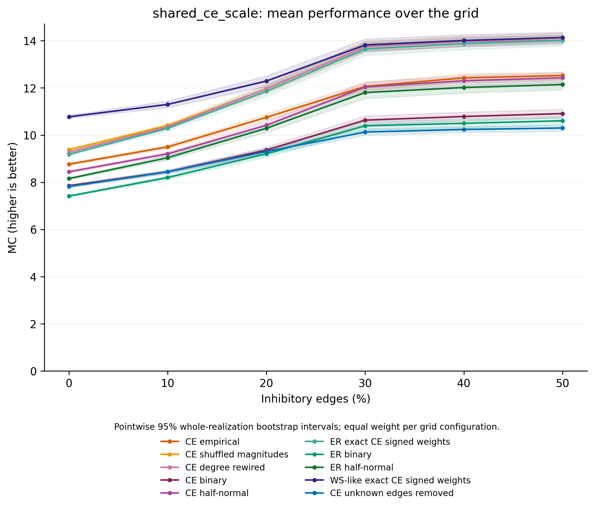
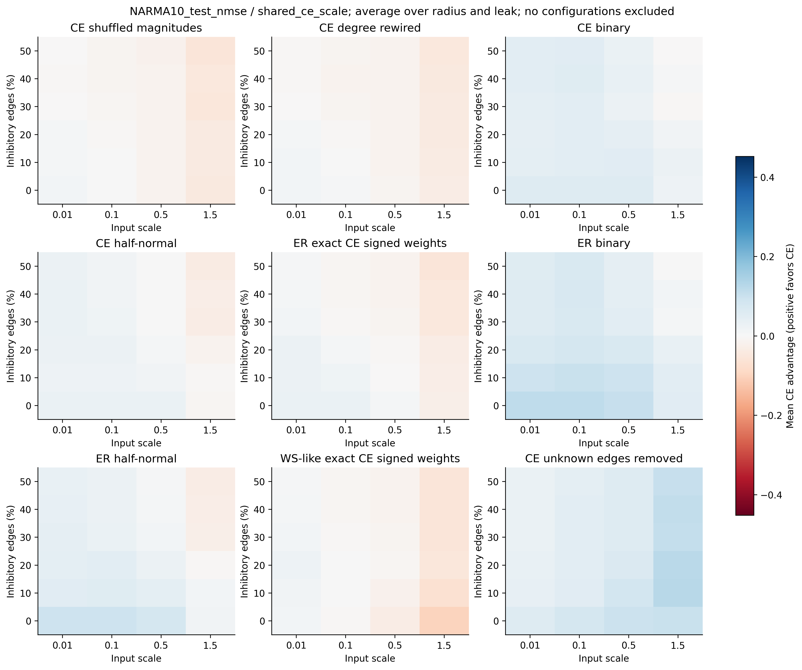

# What the architecture controls isolate — results and interpretation

**Run:** `architecture_mc_narma_271846`  
**Scope:** 432,000 paired MC/NARMA10 evaluations; 100 realizations; ten models; six inhibitory-edge fractions (0–50%); 24 settings; three normalization protocols.

## Main finding

The controls substantially narrow the original biological-advantage claim. **CE's advantage over binary ER does not establish an advantage of the empirical connectome's wiring or weight placement.** Giving ER the exact signed CE weight multiset removes most of the MC advantage, and redistributing CE magnitudes on its own topology improves average MC and NARMA performance. These results persist in relevant comparisons under a common multiplier, so they are not solely a consequence of assigning every network its own spectral-radius normalization.

There are still useful conditional results: weak-input NARMA performance can favor CE under common scaling; CE topology can help when the magnitude assignment is controlled; and normalization strongly changes the apparent extent of CE's advantage. The evidence supports a systematic account of those dependencies rather than a universal biological advantage or a claim that CE is intrinsically a poor reservoir.

## 1. What each comparison actually tests

The most direct weight-placement and topology comparisons below use **shared-CE scaling**, where the same multiplier is applied to every model within a realization, fraction and target setting. Own-radius and per-family fixed-reference comparisons additionally change family-specific multipliers.

| Comparison | Properties held fixed | What it tests | Remaining limits |
| --- | --- | --- | --- |
| CE empirical vs CE shuffled | CE edge mask, exact edge signs, global signed-weight multiset, common multiplier | Whether empirical magnitude placement helps on this topology | Shuffling changes neuron strengths and spectral properties together; it does not identify a particular motif or mode. |
| CE empirical vs CE degree rewired | Node/edge counts, directed in/out degrees, each source's signed outgoing-weight multiset, common multiplier | Organization beyond those degree and outgoing-weight constraints | Incoming strengths, sign-specific incoming degrees, motifs and spectra can change; rewiring is not a single-feature intervention. |
| CE empirical vs ER exact signed weights | Node/edge counts, exact signed-weight multiset, common multiplier | CE organization relative to this directed random-graph ensemble | Degree sequences and spatial weight/sign organization change together; not topology independent of every weight-placement effect. |
| CE empirical vs CE binary / CE half-normal | CE edge mask and edge sign mask | Sensitivity to replacing empirical magnitudes | Binary/half-normal replacement changes several distributional properties and empirical placement; it does not isolate the long tail alone. |
| ER exact signed weights vs ER binary / ER half-normal | Same ER edge mask and sign mask | Effect of magnitude choices on the random topology | Spectra and dynamics change with magnitudes; this is not a topology comparison. |
| CE binary vs ER binary; CE half-normal vs ER half-normal | Matched signed magnitudes, node/edge counts, common multiplier | Topology comparisons without empirical magnitude placement | Degree patterns and assignment of signs/magnitudes still differ; neither ensemble is a universal random-network optimum. |
| CE empirical vs WS-like exact signed weights | Node/edge counts, exact signed-weight multiset, common multiplier | Comparison with a structured artificial topology | Directed WS-like construction at one rewiring probability (.1); degree pattern and weight placement also differ. |
| CE empirical vs unknown-edge removal | Node count and surviving raw magnitude units | Dependence on completing the unknown-sign edge set | Edge count changes from 3,604 to 1,740; each mask has its own sign quota. This does not isolate uncertainty of signs alone. |

“Held fixed” does not mean every dynamical property is matched: changing edge destinations or weight placement is expected to change spectra and dynamics. The controls identify effects of the specified matrix transformations, not an individual dynamical mechanism.

## 2. A concrete comparison at 20% inhibitory edges

These are means over all 24 settings and all 100 realizations. Higher MC is better; lower NARMA NMSE is better. Use the paired difference table below for uncertainty, rather than comparing separate mean intervals.

| Model | Own radius: MC | Own radius: NMSE | Shared multiplier: MC | Shared multiplier: NMSE |
| --- | --- | --- | --- | --- |
| CE empirical | 10.755 | 0.1837 | 10.755 | 0.1837 |
| CE shuffled magnitudes | 12.929 | 0.1471 | 11.959 | 0.1707 |
| CE degree rewired | 12.823 | 0.1486 | 11.966 | 0.1708 |
| CE binary | 9.988 | 0.1875 | 9.368 | 0.2204 |
| CE half-normal | 11.181 | 0.1642 | 10.419 | 0.1953 |
| ER exact CE signed weights | 14.857 | 0.1308 | 11.864 | 0.1833 |
| ER binary | 11.131 | 0.1671 | 9.209 | 0.2461 |
| ER half-normal | 12.812 | 0.1472 | 10.291 | 0.2124 |
| WS-like exact CE signed weights | 15.299 | 0.1359 | 12.292 | 0.1750 |
| CE unknown edges removed | 9.939 | 0.2265 | 9.306 | 0.2500 |

Under a shared multiplier, empirical CE averages MC 10.755 versus 11.864 for exact-weight ER, 11.959 for shuffled CE and 11.966 for degree-rewired CE. Empirical CE's average NARMA error is approximately tied with exact-weight ER at this fraction, while shuffled and degree-rewired CE have lower error.

### Paired mean differences under the shared multiplier

Positive values favor the **first** model: first minus second for MC; second minus first for NMSE. Brackets are pointwise 95% intervals from 2,000 paired-realization bootstrap draws. Average the 24 settings within each realization before resampling.

| First vs second | MC advantage [95% interval] | NMSE advantage [95% interval] |
| --- | --- | --- |
| CE empirical vs ER binary | +1.55 [+1.48, +1.61] | +0.0624 [+0.0563, +0.0684] |
| CE empirical vs ER exact CE signed weights | -1.11 [-1.23, -1.00] | -0.0005 [-0.0037, +0.0027] |
| CE empirical vs CE shuffled magnitudes | -1.20 [-1.31, -1.10] | -0.0130 [-0.0161, -0.0099] |
| CE empirical vs CE degree rewired | -1.21 [-1.32, -1.11] | -0.0130 [-0.0161, -0.0099] |
| CE binary vs ER binary | +0.16 [+0.11, +0.20] | +0.0257 [+0.0226, +0.0288] |
| CE half-normal vs ER half-normal | +0.13 [+0.06, +0.18] | +0.0171 [+0.0149, +0.0196] |
| ER exact CE signed weights vs ER binary | +2.65 [+2.57, +2.74] | +0.0628 [+0.0587, +0.0671] |
| CE shuffled magnitudes vs ER exact CE signed weights | +0.10 [-0.02, +0.20] | +0.0125 [+0.0107, +0.0143] |

The binary and half-normal CE–ER comparisons show that CE topology can provide a modest average benefit at the same multiplier and matched magnitudes. Yet empirical CE loses MC to exact-weight ER and to its own magnitude-shuffled control. Therefore the results do not support treating empirical topology and empirical magnitude placement as a single beneficial biological package.



*Figure 1. The high-performing shuffled CE, rewired CE and exact-weight ER curves are much closer to one another than empirical CE is to those controls. Similar curves do not prove identical mechanisms.*

## 3. How much does the comparator change the crossover story?

The table gives the **percentage of the 24 configurations whose realization-averaged score favors CE**, at 20% inhibition. This is not the percentage of individual seeds won and not a significance count.

| CE versus control | Own radius: MC / NARMA wins | Fixed reference: MC / NARMA wins | Shared multiplier: MC / NARMA wins |
| --- | --- | --- | --- |
| ER binary | 25.0% / 29.2% | 62.5% / 54.2% | 87.5% / 83.3% |
| ER half-normal | 0.0% / 4.2% | 0.0% / 0.0% | 54.2% / 79.2% |
| ER exact CE signed weights | 0.0% / 0.0% | 0.0% / 0.0% | 12.5% / 45.8% |
| WS-like exact CE signed weights | 0.0% / 0.0% | 0.0% / 8.3% | 8.3% / 41.7% |
| CE shuffled magnitudes | 0.0% / 0.0% | 0.0% / 0.0% | 4.2% / 37.5% |
| CE degree rewired | 0.0% / 0.0% | 0.0% / 0.0% | 4.2% / 37.5% |

With own-radius scaling, CE loses MC to exact-weight ER, shuffled CE and degree-rewired CE in **all 144 configuration–fraction cells** (24 settings × six fractions). This is a statement about mean scores over realizations, not every individual realization. In contrast, under the shared multiplier CE beats binary ER in 87.5–91.7% of settings at every sampled fraction, so that particular advantage is not confined to E/I extremes.

At 0% inhibition the exact-weight ER comparison also changes with normalization: CE wins MC in 0/24 settings under own-radius scaling, 16/24 under fixed-reference scaling and 6/24 under shared scaling. There is no single architecture-independent crossover point. A crossover must be defined for a task, comparator, normalization and hyperparameter slice or fixed grid weighting. A grid-mean crossover and a 50%-win-fraction crossing need not coincide.

The 10-percentage-point fraction spacing brackets changes; it does not locate an exact crossing or predict a biological E/I fraction. In particular, the 24.25% biological-reference number here is used to set a normalization reference, not measured as a crossover observation.

## 4. Weak input still matters, but differently for MC and NARMA

At 20% inhibition and input scale .01, there are six radius/leak settings:

| Normalization | CE MC wins | CE NARMA wins | Mean MC advantage [95% interval] | Mean NMSE advantage [95% interval] |
| --- | --- | --- | --- | --- |
| own_radius | 0/6 | 0/6 | -6.44 [-6.69, -6.19] | -0.0462 [-0.0493, -0.0431] |
| fixed_reference | 0/6 | 0/6 | -6.24 [-6.49, -5.99] | -0.0443 [-0.0503, -0.0390] |
| shared_ce_scale | 2/6 | 6/6 | -1.10 [-1.28, -0.92] | +0.0260 [+0.0236, +0.0285] |

Thus the weak-input NARMA advantage **survives exact signed-weight matching under a common multiplier** in all six settings. The same statement fails for MC: CE wins only two of six settings and its mean MC is lower. Under own-radius and fixed-reference scaling CE loses both tasks in all six settings in this slice.

This supports a conditional nonlinear-task advantage, not a general claim that CE has better long-term memory under weak drive. It also shows why averaging across input levels can hide a real conditional NARMA effect: under shared scaling, the average over the full grid is nearly tied even though the .01-input slice favors CE.



*Figure 2. Positive values favor empirical CE; the input-specific task advantage depends strongly on the control family. Values average over radius and leak and should not be read as a win count.*

## 5. What normalization isolates

| Protocol | What is held fixed | Question answered |
|---|---|---|
| Own radius | Current spectral radius equals the requested target in each family | How do normalized reservoirs compare at equal current radius? Applied gains and final weight distributions can differ. |
| Per-family fixed reference | Each family's multiplier is fixed across the E/I sweep at a given target | What happens when edge signs change without recalculating that family's multiplier at every fraction? Multipliers still differ between families. |
| Shared CE multiplier | Every family receives the empirical CE multiplier at the current fraction and target | How do matrices compare under the same applied gain, preserving exact signed-weight matching where designed? Their resulting radii differ. |

The shared protocol is not an unnormalized run or a single multiplier fixed across the E/I sweep. It uses CE as the gain reference and therefore is not a uniquely neutral normalization. Own-radius and shared scaling give **identical empirical CE performance** by construction; the comparator's scaling changes. Their contrast is especially informative about how normalization changes the apparent CE advantage.

These controls show substantial normalization dependence. They do not identify a unique percentage of the biological–artificial difference “caused by normalization,” or separate radius from every other dynamical consequence of scaling.

## 6. Hyperparameter contributions

The decomposition uses the complete 3 × 2 × 4 radius/leak/input grid within each realization and fraction. Main effects and interactions reconstruct the grid variance. The allocation below divides each interaction equally among participating parameters, then averages percentage shares equally over realizations and fractions. It is a descriptive allocation, not a causal or universal importance score.

Selected results under own-radius scaling:

| Model | Metric | Input scale | Leak | Radius target |
| --- | --- | --- | --- | --- |
| CE empirical | MC | 73.2% | 19.9% | 6.8% |
| CE empirical | NARMA NMSE | 52.5% | 31.6% | 15.9% |
| CE shuffled magnitudes | MC | 65.4% | 25.8% | 8.8% |
| CE shuffled magnitudes | NARMA NMSE | 29.0% | 50.9% | 20.2% |
| CE degree rewired | MC | 66.4% | 25.0% | 8.6% |
| CE degree rewired | NARMA NMSE | 36.0% | 43.1% | 20.9% |
| ER exact CE signed weights | MC | 62.5% | 29.0% | 8.5% |
| ER exact CE signed weights | NARMA NMSE | 26.7% | 50.4% | 22.9% |
| ER binary | MC | 57.5% | 32.1% | 10.4% |
| ER binary | NARMA NMSE | 29.9% | 46.5% | 23.6% |
| CE unknown edges removed | MC | 79.3% | 14.8% | 5.9% |
| CE unknown edges removed | NARMA NMSE | 72.9% | 19.8% | 7.3% |

Input scale dominates MC variation in these models. Empirical CE's NARMA variation is also most strongly allocated to input, whereas leak receives the largest share for exact-weight ER, shuffled CE and degree-rewired CE. This describes different response surfaces; it does not imply that one architecture is more computationally robust. Bias is fixed, so its importance cannot be estimated from this run.

## 7. Diagnostics that limit a stronger claim

**Some configurations retain sensitivity to initialization after washout.** Comparing the zero initial state with a second state initialized to .5 gives an RMS state gap. An exploratory cutoff of 10^-3 flags 7.9% of CE MC configurations and 6.0% of CE NARMA configurations at 20% inhibition under own/shared-CE scaling. Under fixed-reference scaling at 0%, the corresponding NARMA rates are 34.2% for CE, 48.4% for binary ER and 48.6% for exact-weight ER. These percentages include all settings and realizations, not independent network samples. They are not proof of instability or a formal echo-state-property test; they show why the fixed-reference endpoint advantages should not yet be described as initialization-independent computation. No flagged results were discarded.

**Large NARMA errors affect means.** The largest test NMSE is 73.13 for shuffled CE under fixed-reference scaling at 30% inhibition (repeat 29, radius target 1.05, leak 1, input .5), despite validation NMSE .0438. Its NARMA washout initialization gap is approximately zero. This shows that a small washout gap does not guarantee reliable test generalization, and that this outlier cannot simply be attributed to that diagnostic. It remains in the mean. Inspect medians, error tails and per-realization distributions before interpreting small average differences near a crossing.

**MC is truncated.** Primary MC includes delays 1–30; the run also stores 31–60 and the extended sum. At 20% inhibition and input .01, empirical CE also loses extended MC to exact-weight ER under all three normalizations. In that slice, the observed MC deficit is not reversed merely by including delays through 60. This does not settle behavior beyond delay 60.

**An eigenmode mechanism remains unisolated.** The controls establish dependencies on weight assignment, graph organization and scaling. They do not show that particular secondary eigenvalues cause a performance difference. Magnitude shuffling and rewiring simultaneously change spectra, input coupling and other matrix properties. This report does not use the earlier mode-suppression pilot as proof for the new protocol.

## 8. What the paper can now say

A defensible framing is:

> The computational effect of a connectome-derived reservoir depends on the joint choice of synaptic magnitude assignment, sign balance, task, input drive and normalization. Advantages over binary random reservoirs are substantially reduced by matching the signed-weight distribution. Empirical weight placement is not optimal for the tested tasks: shuffled and degree-rewired controls often perform better. A conditional weak-input NARMA advantage remains under shared scaling, while the analogous MC advantage is not general.

The contribution is the controlled map of these dependencies. Neither “CE is generally better” nor “CE cannot make a useful reservoir” follows. Nor does the dataset establish biological optimization for these tasks: magnitudes are contact-count-derived proxies, edge signs are imposed randomly, inputs target all nodes, and the reservoirs use static tanh dynamics.

## Sources and reproducibility

- Input results: `results/architecture_mc_narma/architecture_mc_narma_271846/architecture_mc_narma.ALL.csv`; SHA256 `c5939609492cd4b7ba791d21579b3048e3d1ea8c2885692a01e7938b99cf6d8b`.
- The source CSV and every existing analysis artifact were checked against their recorded hashes. All 432,000 rows are finite for the inspected numerical fields, have unique condition keys, and form complete 24-setting surfaces for all 100 realizations.
- Model definitions are taken from the run's frozen `snapshot/network_stats/architecture_sweep.py`, with its manifest and passing NVIDIA L40S preflight. No simulations were rerun for this report.
- The experiment uses conventional EchoTorch NARMA10, float64 states/readouts and validation-selected ridge penalties. It is a different protocol from the archived ReservoirPy NARMA runs and should not be pooled with them.
- Four nonfinite generated task streams were replaced according to the recorded rule before reservoir evaluation; all conditions received the same accepted stream within a realization. This report performs no performance filtering.
- Existing figure intervals and win curves use 1,000 whole-realization bootstrap draws. New paired mean contrasts use 2,000 draws, seed 20261119, with common draws across comparisons. Intervals are pointwise and exploratory, not multiplicity-adjusted evidence from a prespecified hypothesis test. The grid and fraction weights are fixed design choices.
- Supporting calculations: [paired mean contrasts](paired_mean_contrasts.csv), [initialization diagnostics](initialization_diagnostics.csv), [largest NARMA errors](largest_narma_errors.csv), [verification record](verification.json). Existing figures and reports were preserved.

The new paired contrasts can be reproduced from the repository root with:

```bash
python analysis/architecture_mc_narma/architecture_mc_narma_271846/control_interpretation/compute_contrasts.py \
  --out-dir /tmp/recomputed-architecture-contrasts
```

Use a new output directory; the calculation refuses to overwrite existing files.
