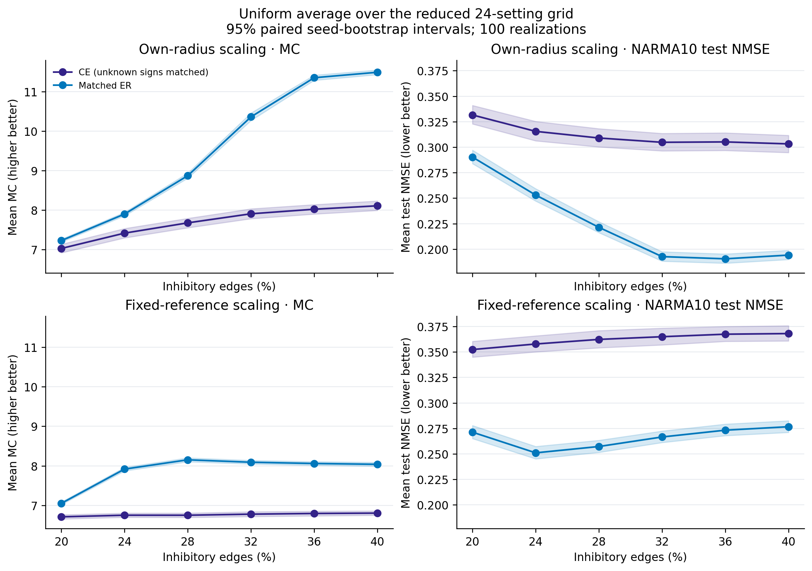
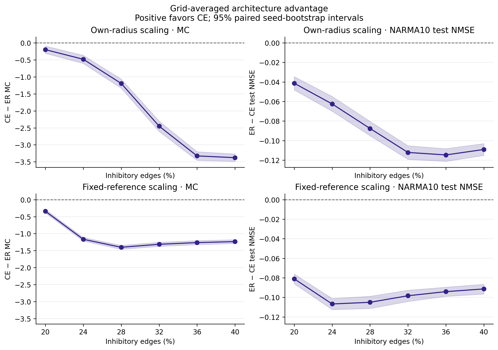
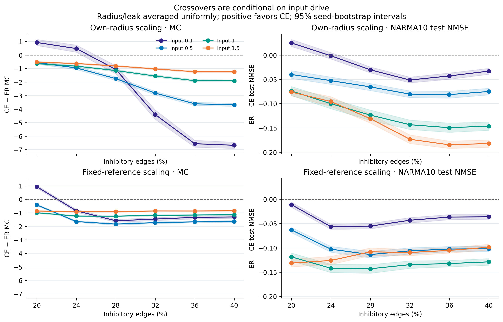
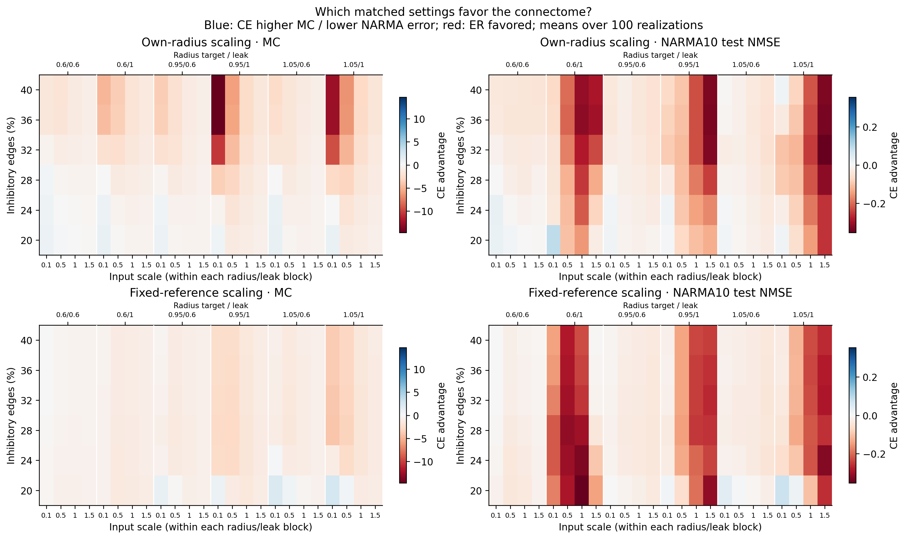
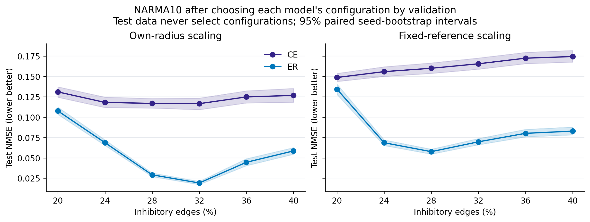
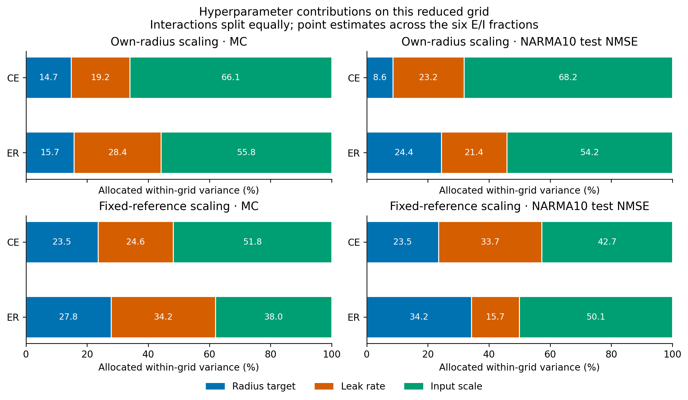
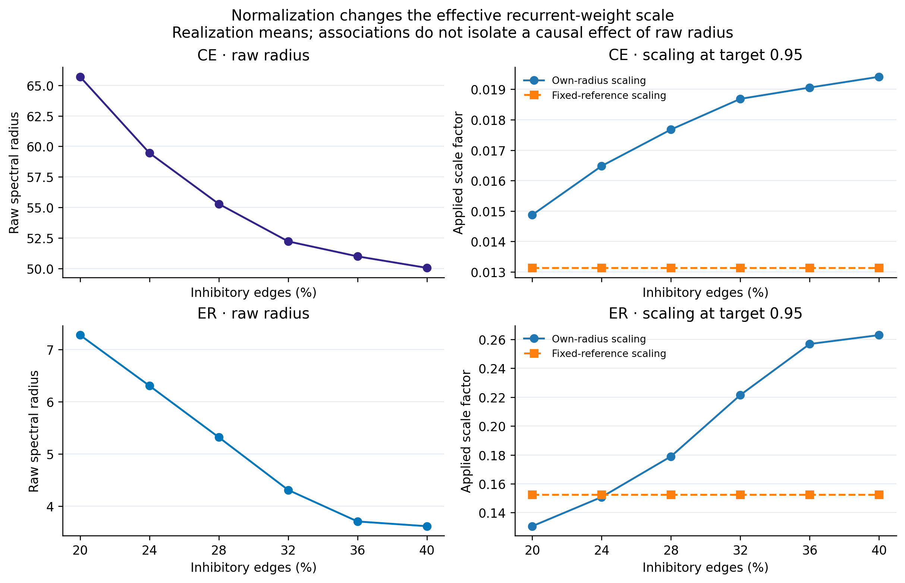

# Under which conditions does a connectome-derived reservoir outperform matched ER?

Stored run 271601: **100 paired computational realizations, 57,600 rows, 24 settings per condition**. Both normalization modes; zero reservoir bias; fractions 20, 24, 28, 32, 36 and 40%. No simulations were launched for this analysis.

## Main findings

**The general grid-averaged crossover is not reproduced inside 20–40%.** ER has higher mean MC and lower mean NARMA10 test error at every sampled fraction when all 24 settings are weighted equally; every corresponding paired pointwise 95% interval favors ER. After averaging radius and leak, CE's positive advantage appears at weak input and is narrower for NARMA10. Individual matched configurations can retain CE advantages under both normalizations. This answers a conditional performance question rather than supporting general biological superiority.

Both panels average within realization before bootstrapping complete paired realizations. NARMA advantage is ER error minus CE error, so positive always favors CE. Bands are marginal 95% seed-bootstrap intervals, not simultaneous confidence bands.

## Conditional crossover locations

| Metric | Normalization | Input scope | Mean sign-change bracket (%) | Interpolated crossing (%) | Bootstrap interval (%) | Unique-root bootstrap fraction |
| --- | --- | --- | --- | --- | --- | ---: |
| MC | Own-radius scaling | input_0.1 | 24–28 | 25.24 | [24.54, 25.90] | 1.000 |
| NARMA10 test NMSE | Own-radius scaling | input_0.1 | 20–24 | 23.78 | [22.80, 24.66] | 1.000 |
| MC | Fixed-reference scaling | input_0.1 | 20–24 | 22.08 | [21.86, 22.30] | 1.000 |

At input scale 0.1 and 20% inhibitory edges, CE's own-radius MC advantage is +0.9274 [+0.7029, +1.1513]; its NARMA advantage is +0.0249 [+0.0176, +0.0321] NMSE, where positive means lower CE error. At 24%, the NARMA difference is -0.0015 [-0.0081, +0.0052], so the models are not clearly separated there. Under fixed-reference scaling, even the weak-input NARMA advantage at 20% reverses: -0.0111 [-0.0165, -0.0059].

Scopes without a crossing are retained in `tables/crossovers.csv`; they are not assigned extrapolated roots. The intervals describe seed uncertainty of a **piecewise-linear interpolant**, conditional on a unique crossing. They do not identify the unknown curve shape between 4-percentage-point grid samples. A narrow interval is not evidence of sub-grid experimental resolution.

The biological approximately 24.25% edge fraction is not an independently predicted optimum. That fraction already enters unknown-sign completion and the fixed-reference construction; the sweep randomizes edge signs. Input setting and normalization change the comparison.

The configuration heatmap retains parameter-specific counterexamples hidden by averages. Counts of favorable point estimates and intervals are in `tables/configuration_win_counts.csv`; these 24 grid settings are not independent network samples.

**Illustrative matched condition:** at 20% inhibitory edges, radius target 1.05, leak 1.0 and input scale 0.1, CE outperforms ER on both metrics under both normalizations. This example was identified after inspecting the full configuration map; it is descriptive and its intervals are not multiplicity-adjusted.

| Normalization | Metric | CE advantage [pointwise 95% interval] |
| --- | --- | --- |
| Own-radius scaling | MC | +0.9842 [+0.6696, +1.3002] |
| Own-radius scaling | NARMA10 test NMSE | +0.0119 [+0.0046, +0.0193] |
| Fixed-reference scaling | MC | +2.5226 [+2.3273, +2.7274] |
| Fixed-reference scaling | NARMA10 test NMSE | +0.0765 [+0.0681, +0.0856] |

## NARMA10 with validation-selected configurations

For each realization, architecture, normalization and E/I fraction, select the lowest **validation** NMSE among 24 configurations; report its untouched test score. Ridge alpha was already selected using validation within each configuration. Test scores do not choose either parameter setting or ridge penalty. These selection results and the uniformly averaged surfaces answer different questions.

**ER has lower validation-selected mean test error at all six fractions under both normalizations; all paired pointwise intervals favor ER.** Thus the observed weak-input matched-setting advantage does not establish a tuning advantage over the random reservoir.

| Normalization | E/I (%) | CE test NMSE | ER test NMSE | ER − CE error [95% interval] |
| --- | ---: | ---: | ---: | --- |
| Own-radius scaling | 20 | 0.1310 | 0.1076 | -0.0233 [-0.0296, -0.0170] |
| Own-radius scaling | 24 | 0.1180 | 0.0686 | -0.0495 [-0.0563, -0.0426] |
| Own-radius scaling | 28 | 0.1169 | 0.0291 | -0.0877 [-0.0942, -0.0811] |
| Own-radius scaling | 32 | 0.1165 | 0.0191 | -0.0974 [-0.1042, -0.0901] |
| Own-radius scaling | 36 | 0.1248 | 0.0445 | -0.0803 [-0.0884, -0.0724] |
| Own-radius scaling | 40 | 0.1267 | 0.0585 | -0.0682 [-0.0767, -0.0601] |
| Fixed-reference scaling | 20 | 0.1487 | 0.1343 | -0.0144 [-0.0210, -0.0075] |
| Fixed-reference scaling | 24 | 0.1559 | 0.0685 | -0.0873 [-0.0933, -0.0813] |
| Fixed-reference scaling | 28 | 0.1600 | 0.0576 | -0.1024 [-0.1086, -0.0964] |
| Fixed-reference scaling | 32 | 0.1655 | 0.0697 | -0.0958 [-0.1023, -0.0896] |
| Fixed-reference scaling | 36 | 0.1724 | 0.0801 | -0.0923 [-0.0995, -0.0856] |
| Fixed-reference scaling | 40 | 0.1744 | 0.0828 | -0.0916 [-0.0981, -0.0848] |

## Hyperparameter contributions

Exact finite-grid factorial variance decomposition includes all main effects and interactions of radius, leak and input scale. Each interaction is allocated equally among its participating parameters. Summaries divide the sum of within-E/I component variances by the sum of within-E/I total variances. They exclude changes between E/I means and depend on this reduced grid. Bootstrap recomputes each seed-averaged surface and decomposition; intervals are in the tables.

## Normalization and provenance

The same raw realizations and input weights are paired across normalization schemes. Fixed-reference scaling changes the effective recurrent gain across fractions. Its effects are descriptive protocol contrasts; a radius correlation does not identify topology's causal contribution.

The old 96-setting results and this 24-setting run must not be pooled. The new run has fresh seeds, shared NumPy-generated task inputs, and float64 MC readout fitting. Its reservoir dynamics remain float32. At 20%, the old updated sign sweep restricted to the same 24 settings gives CE − ER MC = +0.461; the new grid-average contrast is -0.1990 [-0.3076, -0.0942]. Changes in grid composition alone therefore cannot explain the altered ordering. The old full grid, bias-zero subset, exactly matched reduced grid and new endpoint means are exported in `tables/old_grid_comparison.csv`. The available tables do not isolate the contribution of numerical precision from input/realization changes.

NARMA10 is generated by ReservoirPy 0.4.2 with its upstream recurrence/lag conventions unchanged; states after input u[t] predict the next output. Inputs are U[0,0.5], with 1,000 target burn-in, 500 state washout, 1,500 training, 500 validation and 500 test steps. Readout is scikit-learn Ridge with intercept. MC uses U[-1,1], delays 1–30, 1,500 training and 500 test after 500 washout. Full settings are copied to the manifest. ReservoirPy's specific lag convention should be cited when comparing to other NARMA implementations.

CE retains biological weight magnitudes, while matched ER uses the existing binary sign-sweep weights. This is an architecture-and-weight comparison, not an isolated test of topology. Seed repeats are computational realizations of one anatomical connectome, not independent animals. All settings/fractions are a chosen finite design; no configuration is treated as an independent biological replicate. MC is truncated at delay 30 and some individual scores approach that ceiling; it is not unrestricted memory capacity.

The run used both NVIDIA L40S and A30 GPUs. Every realization has a complete paired panel on its assigned device. Device-stratified descriptive contrasts are exported; GPU and repeat IDs are confounded, so between-device differences cannot be interpreted as hardware effects.

## Validation and files

All 1,200 source shards match the merged table; all grid cells are complete and unique; all metrics are finite; all MC values lie within the documented bound; NRMSE squared matches NMSE. Simulation code and connectome hashes match the manifests. No filtering or score clipping was applied.

`tables/performance.csv`, `contrasts.csv`, `crossovers.csv`, `validation_selected_narma.csv`, `parameter_contributions.csv`, and configuration-level tables retain counterexamples and uncertainty. `manifest.json` records source hashes and analysis settings. `VALIDATION.json` records the audit. All figures are PNGs.
