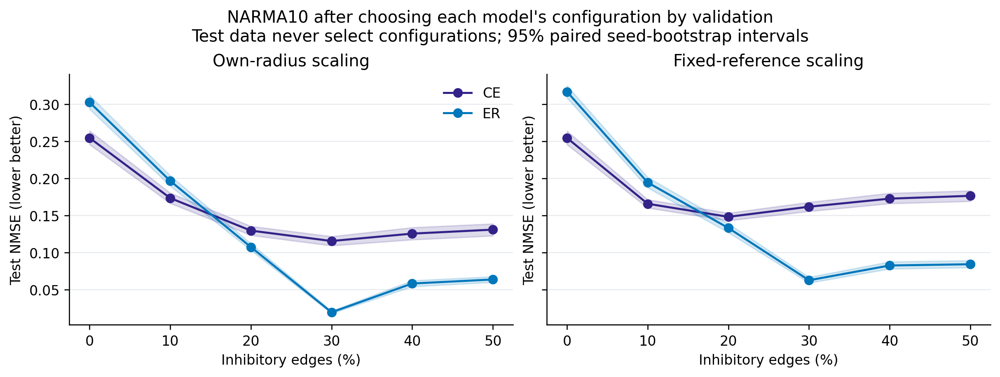
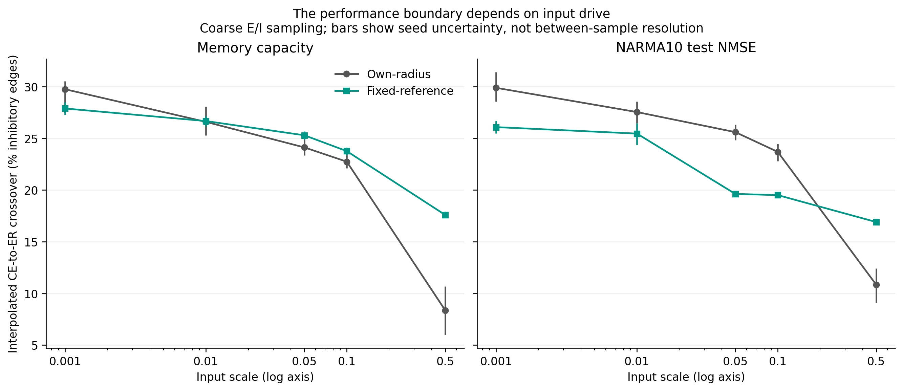

# Run 271800: important findings

100 paired computational realizations; 72,000 rows; 30 settings per condition. Static reservoirs, with empirical-weight CE versus binary-weight ER; this is not the STP/weighted-control sweep.

**The clearest extension is an advantage at strongly imbalanced E/I that also appears on NARMA10 after validation-based tuning.** CE has lower selected-setting NARMA test error at 0% and 10% inhibition under both normalization protocols; ER has lower selected-setting test error at 20–50%. All twelve corresponding pointwise paired intervals exclude zero.

| Inhibitory edges | Normalization | CE selected test NMSE | ER selected test NMSE | ER − CE error [95% interval] |
| ---: | --- | ---: | ---: | --- |
| 0% | Own-radius | 0.255 | 0.303 | +0.048 [+0.042, +0.054] |
| 10% | Own-radius | 0.174 | 0.197 | +0.023 [+0.016, +0.030] |
| 0% | Fixed-reference | 0.255 | 0.317 | +0.062 [+0.056, +0.069] |
| 10% | Fixed-reference | 0.166 | 0.195 | +0.029 [+0.023, +0.034] |

**Weaker input moves the interpolated CE–ER boundary toward higher inhibitory fractions.** This is a conditional regime, not a universal advantage at weaker input. Crossovers depend on the input setting, task and normalization.

| Input scale | MC own-radius crossover | MC fixed-reference crossover | NARMA own-radius crossover | NARMA fixed-reference crossover |
| ---: | ---: | ---: | ---: | ---: |
| 0.001 | 29.7% | 27.9% | 29.9% | 26.1% |
| 0.01 | 26.6% | 26.7% | 27.5% | 25.5% |
| 0.05 | 24.1% | 25.3% | 25.6% | 19.6% |
| 0.1 | 22.7% | 23.8% | 23.7% | 19.5% |
| 0.5 | 8.4% | 17.6% | 10.8% | 16.9% |

**These roots are descriptive interpolations, not measurements to 0.1 percentage points.** The sweep samples 0, 10, 20, 30, 40 and 50%. For example, input 0.1 gives an own-radius MC crossing near 22.7% using this grid, versus 25.2% using the earlier finer 20–40% grid. Matched overlapping measurements are nearly identical; the difference demonstrates sensitivity to interpolation resolution. Use the earlier fine sweep for that setting, and do not infer a biological optimum from proximity to the known-edge sign fraction.

**At 20% inhibition, mean comparisons and tuned-task comparisons differ.** Across this newly chosen grid, CE's mean MC advantage is +1.008 [+0.797, +1.225] under own-radius scaling and +0.823 [+0.738, +0.911] under fixed-reference scaling. Nevertheless, validation-selected NARMA favors ER there. Grid averages also change when the input levels change; they are not a direct replication of the previous grid average.

**Input scale is not the dominant MC variance contributor on every grid.** On this mostly weak-input grid with own-radius normalization, allocated CE MC variance is 38.1% leak, 34.0% radius and 27.9% input; ER is 50.1% leak, 34.0% radius and 15.9% input. Those shares include equally allocated interactions and characterize these sampled levels.

**One catastrophic NARMA error strongly affects a mean.** CE repeat 63, 40% inhibition, radius 1.05, leak 0.6 and input 0.01 has test NMSE 604.04 despite validation NMSE 0.233. It is retained. After averaging the six radius/leak settings within each seed at that input/fraction, CE's mean error is 1.233 but its median seed-mean error is 0.221; ER's corresponding values are 0.197 and 0.195. The median paired advantage also favors ER, so the large error exaggerates the mean gap without explaining away ER's typical-seed advantage. Tail and whole-seed leave-one-out diagnostics are exported without filtering the primary analysis.

**Provenance:** all source shards, simulation code and connectome hashes validate. The run reuses the previous 100 seed IDs; 9,600 overlapping rows agree to small numerical differences. Treat it as an expanded design, not an independent 100-seed replication. Weight distribution remains confounded with architecture until the new weighted controls return.

The full report, pointwise intervals, configuration-specific comparisons and allocation tables are in `REPORT.md` and `tables/`. No new simulations, row filtering or PDFs.
