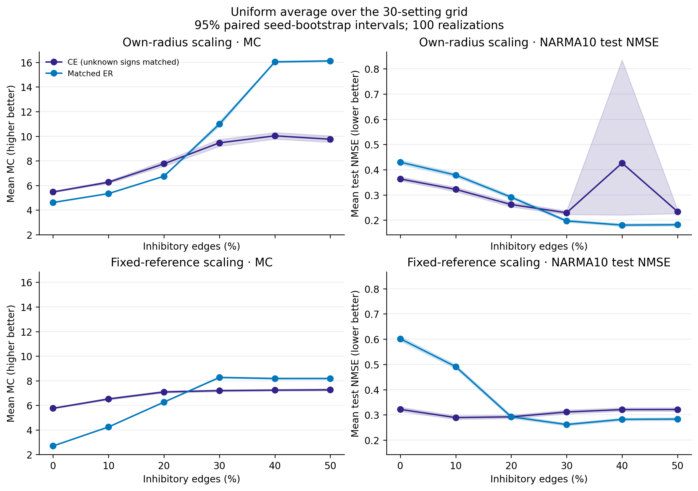
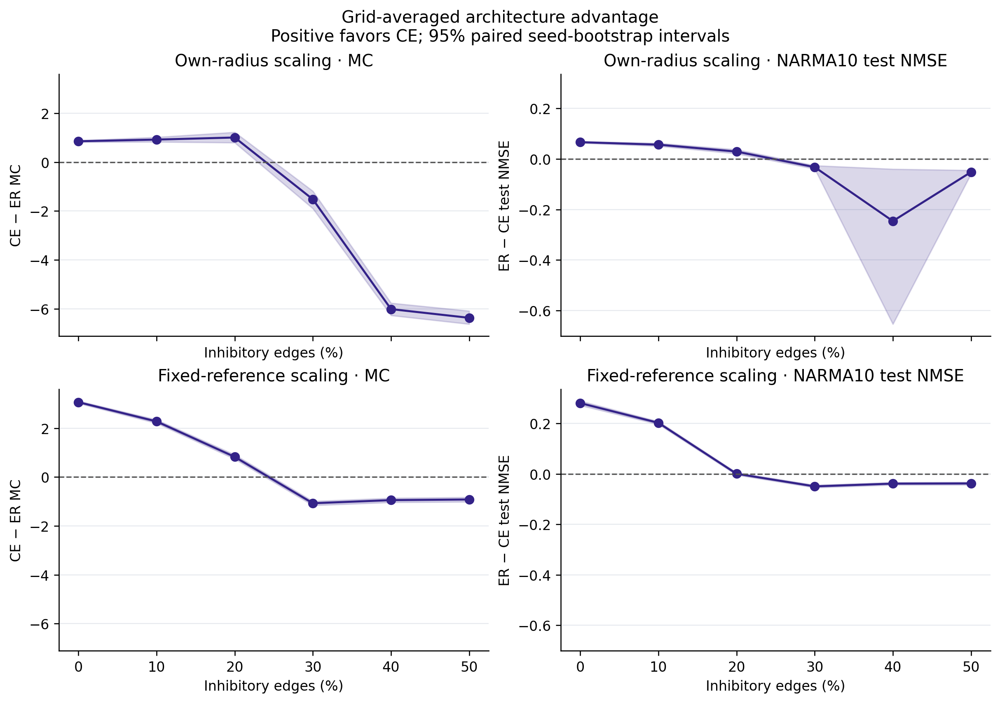
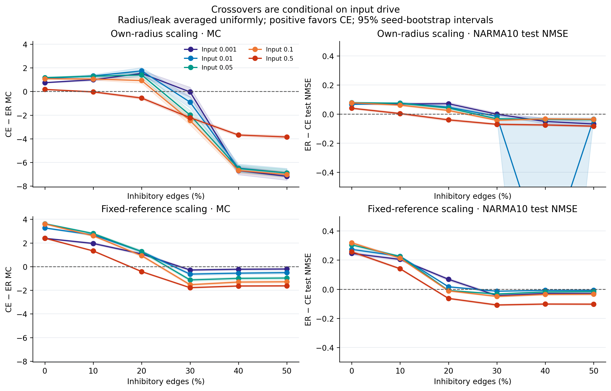
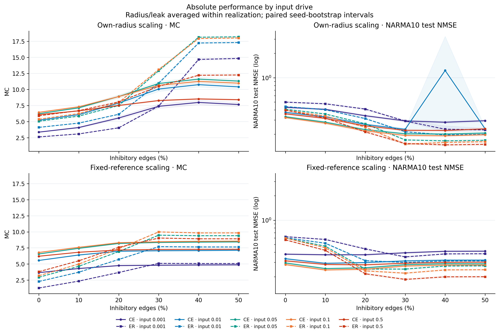
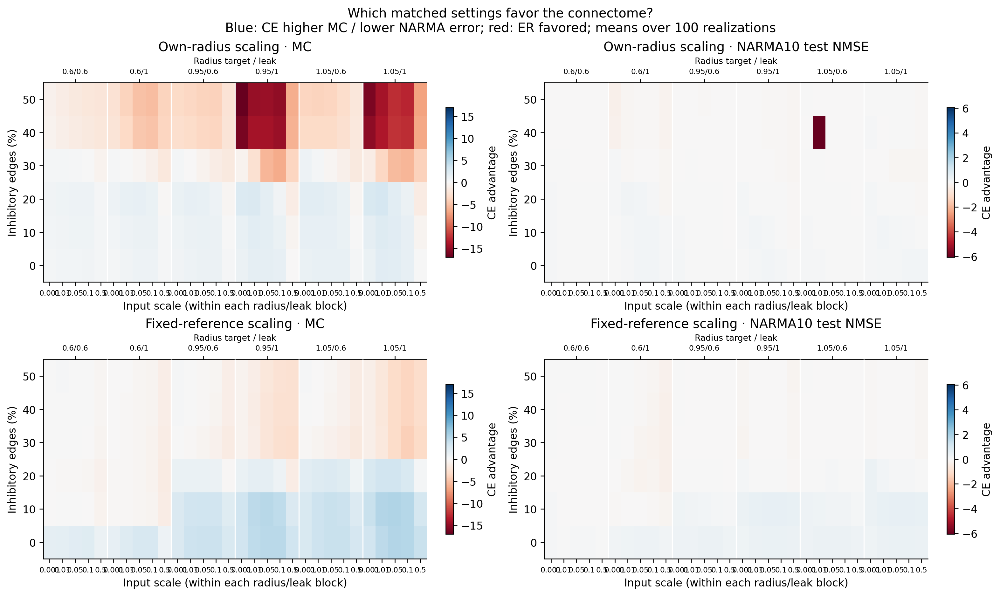
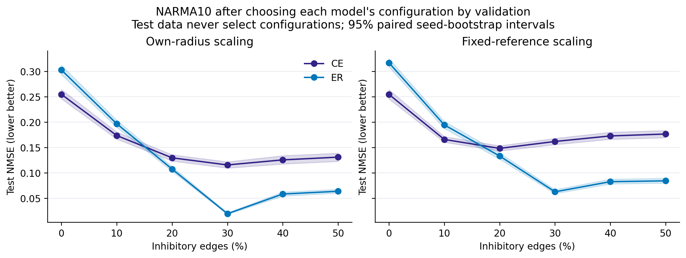
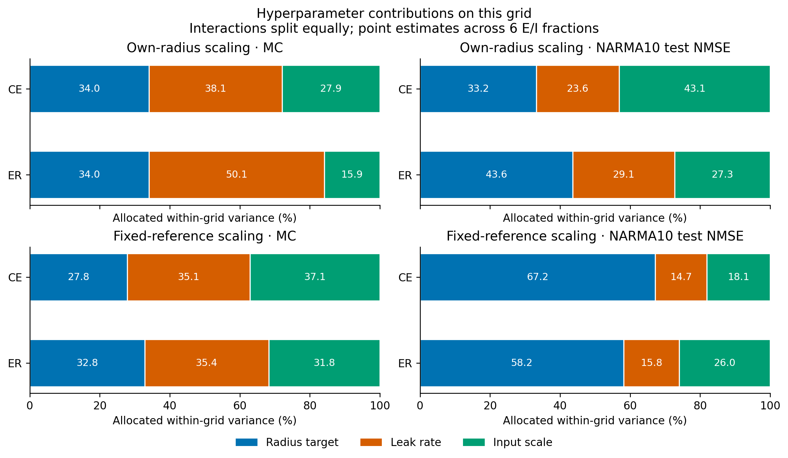
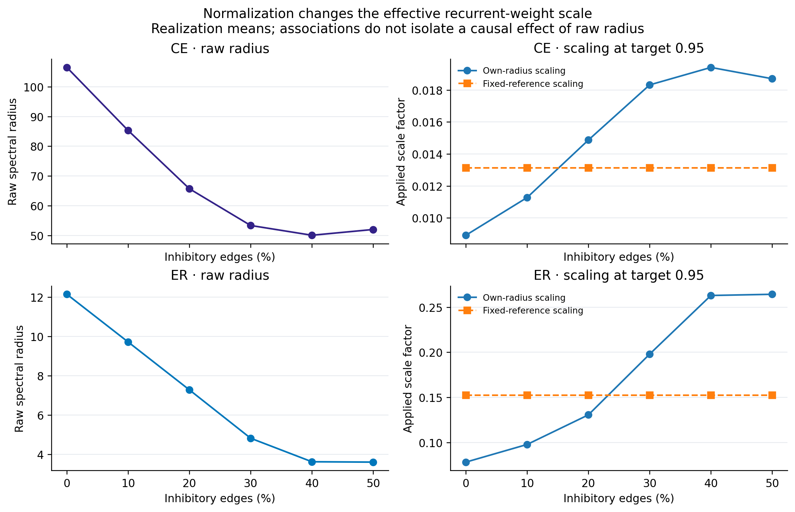

# When does the connectome-derived reservoir outperform matched ER?

Stored run **271800**: **100 paired computational realizations, 72,000 rows, 30 settings per architecture/normalization/E/I condition**. This analysis uses stored static-reservoir results; no simulations were launched.

E/I edge percentages: 0, 10, 20, 30, 40, 50. Input scales: 0.001, 0.01, 0.05, 0.1, 0.5. Radius targets: [0.6, 0.95, 1.05]; leak rates: [0.6, 1.0]; bias: zero.

## Main results

Uniform grid averages, fixed-input comparisons, and validation-selected performance answer different questions. Changing the sampled input levels also changes the grid average.

| Normalization | Metric | CE higher mean / sampled fractions | CE-favoring intervals | ER-favoring intervals |
| --- | --- | ---: | ---: | ---: |
| Own-radius | MC | 3/6 | 3 | 3 |
| Own-radius | NARMA10 test NMSE | 3/6 | 3 | 3 |
| Fixed-reference | MC | 3/6 | 3 | 3 |
| Fixed-reference | NARMA10 test NMSE | 3/6 | 2 | 3 |

Positive CE advantage means CE minus ER MC, or ER minus CE NARMA error. Configurations are averaged within realization before resampling complete paired realizations. All intervals are pointwise 95% percentile seed-bootstrap intervals, not simultaneous or multiplicity-adjusted intervals.

## Dependence on input drive

The smallest input is not assumed to be optimal. Input scaling changes signal amplitude relative to the fixed MC ridge and the candidate NARMA ridge penalties, as well as nonlinear dynamics. These mechanisms are not isolated by a performance curve.

| Input scale | Normalization | Metric | Fractions with CE-favoring intervals (%) | Fractions with ER-favoring intervals (%) |
| ---: | --- | --- | --- | --- |
| 0.001 | Own-radius | MC | 0, 10, 20 | 40, 50 |
| 0.001 | Own-radius | NARMA10 test NMSE | 0, 10, 20 | 40, 50 |
| 0.001 | Fixed-reference | MC | 0, 10, 20 | 30, 40, 50 |
| 0.001 | Fixed-reference | NARMA10 test NMSE | 0, 10, 20 | 30, 40, 50 |
| 0.01 | Own-radius | MC | 0, 10, 20 | 30, 40, 50 |
| 0.01 | Own-radius | NARMA10 test NMSE | 0, 10, 20 | 30, 40, 50 |
| 0.01 | Fixed-reference | MC | 0, 10, 20 | 30, 40, 50 |
| 0.01 | Fixed-reference | NARMA10 test NMSE | 0, 10, 20 | 30, 40, 50 |
| 0.05 | Own-radius | MC | 0, 10, 20 | 30, 40, 50 |
| 0.05 | Own-radius | NARMA10 test NMSE | 0, 10, 20 | 30, 40, 50 |
| 0.05 | Fixed-reference | MC | 0, 10, 20 | 30, 40, 50 |
| 0.05 | Fixed-reference | NARMA10 test NMSE | 0, 10 | 20, 30, 40, 50 |
| 0.1 | Own-radius | MC | 0, 10, 20 | 30, 40, 50 |
| 0.1 | Own-radius | NARMA10 test NMSE | 0, 10, 20 | 30, 40, 50 |
| 0.1 | Fixed-reference | MC | 0, 10, 20 | 30, 40, 50 |
| 0.1 | Fixed-reference | NARMA10 test NMSE | 0, 10 | 20, 30, 40, 50 |
| 0.5 | Own-radius | MC | 0 | 20, 30, 40, 50 |
| 0.5 | Own-radius | NARMA10 test NMSE | 0 | 20, 30, 40, 50 |
| 0.5 | Fixed-reference | MC | 0, 10 | 20, 30, 40, 50 |
| 0.5 | Fixed-reference | NARMA10 test NMSE | 0, 10 | 20, 30, 40, 50 |

## Conditional crossover locations

| Metric | Normalization | Scope | Mean sign-change bracket(s), % | Interpolated root(s), % | Conditional bootstrap interval, % | Unique-root bootstrap fraction |
| --- | --- | --- | --- | --- | --- | ---: |
| MC | Own-radius | grid_mean | 20–30 | 23.99 (CE_to_ER) | [23.12, 24.89] | 1.000 |
| NARMA10 test NMSE | Own-radius | grid_mean | 20–30 | 24.73 (CE_to_ER) | [23.67, 25.66] | 1.000 |
| MC | Fixed-reference | grid_mean | 20–30 | 24.34 (CE_to_ER) | [23.94, 24.75] | 1.000 |
| NARMA10 test NMSE | Fixed-reference | grid_mean | 20–30 | 20.05 (CE_to_ER) | [19.78, 20.89] | 1.000 |
| MC | Own-radius | input_0.001 | 20–30 | 29.75 (CE_to_ER) | [27.47, 30.52] | 1.000 |
| NARMA10 test NMSE | Own-radius | input_0.001 | 20–30 | 29.89 (CE_to_ER) | [28.57, 31.42] | 1.000 |
| MC | Fixed-reference | input_0.001 | 20–30 | 27.89 (CE_to_ER) | [27.28, 28.48] | 1.000 |
| NARMA10 test NMSE | Fixed-reference | input_0.001 | 20–30 | 26.08 (CE_to_ER) | [25.49, 26.69] | 1.000 |
| MC | Own-radius | input_0.01 | 20–30 | 26.59 (CE_to_ER) | [25.29, 28.07] | 1.000 |
| NARMA10 test NMSE | Own-radius | input_0.01 | 20–30 | 27.54 (CE_to_ER) | [26.46, 28.56] | 1.000 |
| MC | Fixed-reference | input_0.01 | 20–30 | 26.67 (CE_to_ER) | [26.17, 27.16] | 1.000 |
| NARMA10 test NMSE | Fixed-reference | input_0.01 | 20–30 | 25.46 (CE_to_ER) | [24.36, 26.46] | 1.000 |
| MC | Own-radius | input_0.05 | 20–30 | 24.12 (CE_to_ER) | [23.34, 24.94] | 1.000 |
| NARMA10 test NMSE | Own-radius | input_0.05 | 20–30 | 25.60 (CE_to_ER) | [24.84, 26.32] | 1.000 |
| MC | Fixed-reference | input_0.05 | 20–30 | 25.29 (CE_to_ER) | [24.89, 25.69] | 1.000 |
| NARMA10 test NMSE | Fixed-reference | input_0.05 | 10–20 | 19.62 (CE_to_ER) | [19.40, 19.85] | 1.000 |
| MC | Own-radius | input_0.1 | 20–30 | 22.74 (CE_to_ER) | [22.10, 23.39] | 1.000 |
| NARMA10 test NMSE | Own-radius | input_0.1 | 20–30 | 23.69 (CE_to_ER) | [22.80, 24.47] | 1.000 |
| MC | Fixed-reference | input_0.1 | 20–30 | 23.76 (CE_to_ER) | [23.40, 24.11] | 1.000 |
| NARMA10 test NMSE | Fixed-reference | input_0.1 | 10–20 | 19.51 (CE_to_ER) | [19.28, 19.73] | 1.000 |
| MC | Own-radius | input_0.5 | 0–10 | 8.36 (CE_to_ER) | [5.97, 10.66] | 1.000 |
| NARMA10 test NMSE | Own-radius | input_0.5 | 10–20 | 10.84 (CE_to_ER) | [9.12, 12.41] | 1.000 |
| MC | Fixed-reference | input_0.5 | 10–20 | 17.59 (CE_to_ER) | [17.28, 17.90] | 1.000 |
| NARMA10 test NMSE | Fixed-reference | input_0.5 | 10–20 | 16.90 (CE_to_ER) | [16.66, 17.13] | 1.000 |

Grid spacings are 10 percentage points. Roots are piecewise-linear interpolations within sampled sign-change brackets; no root is extrapolated. Bootstrap intervals describe seed uncertainty conditional on exactly one crossing, not the unknown shape between sampled fractions. Narrow intervals do not imply sub-grid experimental resolution. Multiple/no-crossing outcomes remain in `tables/crossovers.csv` and `configuration_crossovers.csv`.

The approximately 24.25% known-edge inhibitory fraction already enters unknown-sign completion and fixed-reference construction. Proximity to a crossover is not an independent prediction of biological E/I balance, an optimum, or physiological current balance.

## Matched configurations and NARMA validation selection

All 30 matched settings are retained, including counterexamples. Favorable-setting counts are descriptive; settings are not independent biological replicates.

For each realization, architecture, normalization and E/I fraction, choose among 30 settings using validation NMSE only; report the untouched test score. Within each setting, validation also selects ridge alpha. Neither selection uses test performance.

| Normalization | E/I (%) | CE test NMSE | ER test NMSE | CE advantage [pointwise 95% interval] |
| --- | ---: | ---: | ---: | --- |
| Own-radius | 0 | 0.2548 | 0.3028 | +0.0480 [+0.0420, +0.0539] |
| Own-radius | 10 | 0.1737 | 0.1968 | +0.0231 [+0.0163, +0.0297] |
| Own-radius | 20 | 0.1298 | 0.1077 | -0.0221 [-0.0283, -0.0159] |
| Own-radius | 30 | 0.1158 | 0.0197 | -0.0960 [-0.1026, -0.0896] |
| Own-radius | 40 | 0.1257 | 0.0585 | -0.0673 [-0.0756, -0.0595] |
| Own-radius | 50 | 0.1311 | 0.0639 | -0.0672 [-0.0753, -0.0589] |
| Fixed-reference | 0 | 0.2547 | 0.3170 | +0.0623 [+0.0561, +0.0688] |
| Fixed-reference | 10 | 0.1660 | 0.1946 | +0.0287 [+0.0227, +0.0342] |
| Fixed-reference | 20 | 0.1484 | 0.1333 | -0.0150 [-0.0215, -0.0086] |
| Fixed-reference | 30 | 0.1620 | 0.0629 | -0.0991 [-0.1046, -0.0934] |
| Fixed-reference | 40 | 0.1729 | 0.0828 | -0.0901 [-0.0965, -0.0835] |
| Fixed-reference | 50 | 0.1767 | 0.0845 | -0.0922 [-0.0998, -0.0846] |

Validation-selected comparisons: 4 intervals favor CE, 8 favor ER, and 0 include zero.

## NARMA tail and influence diagnostics

`tables/largest_narma_test_errors.csv` retains the largest errors, with validation error, selected ridge and configuration. `narma_seed_tail_diagnostics.csv` compares means with medians after averaging configurations within each realization, and reports the fraction of paired seeds favoring CE. It also gives the range of means after omitting one whole paired seed at a time. These are descriptive influence checks; no errors or seeds are removed from the primary means, bootstrap intervals or crossover estimates.

## Hyperparameter contributions

Exact finite-grid factorial decomposition includes all radius, leak and input main effects and interactions. Each interaction is divided equally among its participating parameters. Shares are ratios of summed within-E/I component variances to summed within-E/I total variances, excluding between-E/I mean changes. Bootstrap draws recompute the seed-averaged surfaces and decomposition. These shares depend on the sampled grid, not a universal sensitivity measure.

| Architecture | Normalization | Metric | Radius target (%) | Leak (%) | Input scale (%) |
| --- | --- | --- | ---: | ---: | ---: |
| CE | Own-radius | MC | 34.0 | 38.1 | 27.9 |
| CE | Own-radius | NARMA10 test NMSE | 33.2 | 23.6 | 43.1 |
| CE | Fixed-reference | MC | 27.8 | 35.1 | 37.1 |
| CE | Fixed-reference | NARMA10 test NMSE | 67.2 | 14.7 | 18.1 |
| ER | Own-radius | MC | 34.0 | 50.1 | 15.9 |
| ER | Own-radius | NARMA10 test NMSE | 43.6 | 29.1 | 27.3 |
| ER | Fixed-reference | MC | 32.8 | 35.4 | 31.8 |
| ER | Fixed-reference | NARMA10 test NMSE | 58.2 | 15.8 | 26.0 |

## Normalization, provenance and limits

Own-radius and fixed-reference normalization are distinct protocols, paired on the same raw realization. Radius correlations do not isolate causal effects of recurrent gain or topology.

CE retains empirical magnitudes; the matched ER sign-sweep control is binary-weighted. This run is not the newer weighted-control/STP experiment, and cannot separate topology from weight heterogeneity or weight placement. E/I sweeps randomize all edge signs after unknown-sign completion; the sign structure at each fraction is not the biological sign map.

MC uses delays 1–30 and a fixed ridge penalty 0.0001; high scores can approach this truncated ceiling. NARMA10 uses ReservoirPy 0.4.2 with its upstream lag convention and an intercept-fitted scikit-learn Ridge readout. Inputs and all segment lengths are recorded in the manifest. Computational seeds are realizations of one connectome, not independent animals.

Recorded devices: NVIDIA A30, NVIDIA L40S. Device-stratified descriptive summaries are exported. Device assignment and seed IDs are confounded, so device-group differences cannot be attributed to hardware alone.

The previous crossover run shares seed IDs and overlapping configurations with this run. It is not an independent replication. `tables/reference_run_overlap.csv` compares exactly matched settings; `reference_run_overlap_audit.json` records protocol compatibility, pair counts and numerical differences. The datasets are not pooled.

`tables/old_grid_comparison.csv` additionally retains descriptive legacy MC grid averages. Different input grids and historical protocols must not be interpreted as matched contrasts.

## Validation

All 1,200 shards are complete, unique and consistent with the merged table. All scores are finite, MC respects its documented bounds, NRMSE squared matches NMSE, and no rows were filtered or clipped. Source-data and simulation-code hash checks are recorded individually in `VALIDATION.json`; analysis provenance is in `manifest.json`. Figures are PNGs; no PDFs were generated.
