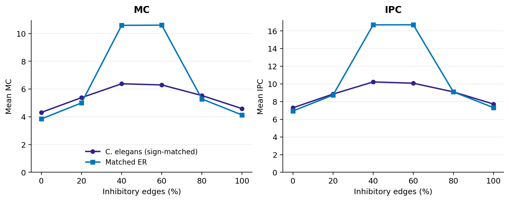
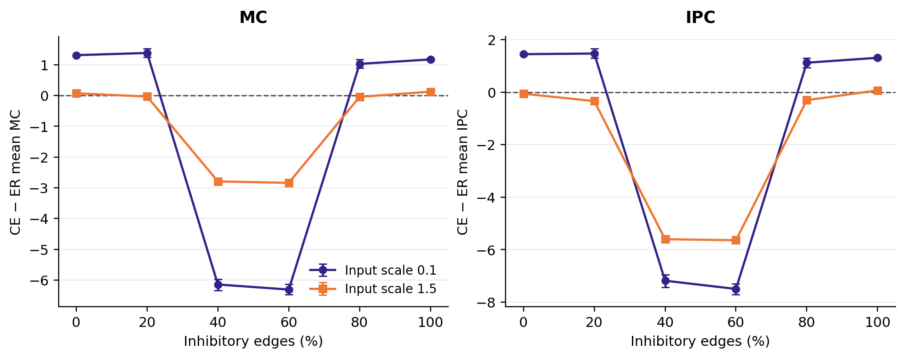
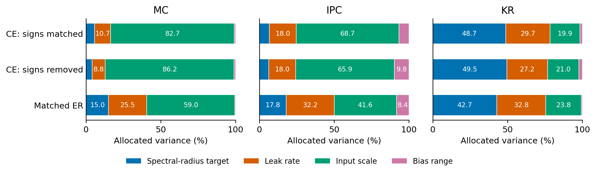

# Preliminary reanalysis: E/I crossovers and hyperparameter dependence

Miles Churchland · 17 November 2026

I’ve been revisiting the reviewers’ concerns using the stored `final_results` data. Two directions look particularly useful: locating where connectome-derived and ER reservoirs exchange their performance advantage, and identifying which hyperparameters drive performance variation. No new simulations were needed for these preliminary results.

## Moving away from the CV claim

I think we should move away from presenting low CV as evidence of computational robustness. Replacing CV with SD, IQR or MAD does not resolve the underlying interpretation: consistently weak reservoirs can have little variation, while higher-performing reservoirs often have both greater dispersion and better lower-tail performance.

## 1. Performance crossovers across E/I balance

A promising result is that the performance ordering between the connectome-derived reservoir and matched ER reverses across the inhibitory-edge sweep. Averaged over the original hyperparameter grid, the sign-matched connectome has higher mean MC and IPC at the strongly imbalanced endpoints (0% and 100% inhibitory edges), whereas ER performs better at 40% and 60%.

These reversals imply performance crossovers: E/I fractions where the two models exchange their advantage. Locating those points would let us describe the conditions under which each architecture performs better. The existing sweep brackets these transitions but does not locate them precisely.

*Figure 1. The performance ordering reverses across the E/I sweep. Points average 96 configurations and 200 seeds under own-radius normalization. Lines connect tested fractions as visual guides; they do not locate the crossovers precisely.*

**Input drive shifts the crossover.** At input scale 0.1, both MC and IPC bracket a lower crossover between 20% and 40%, and an upper crossover between 60% and 80%. At larger input scales, some connectome advantages shrink or reverse. A single crossover therefore needs an explicit input setting or averaging rule.

*Figure 2. Positive values favor CE; negative values favor ER. Other hyperparameters are averaged uniformly. Error bars are existing 95% paired seed-bootstrap intervals (200 seeds); normalization is unchanged from Figure 1.*

**Normalization matters:** the mean MC and IPC advantage at both endpoints persists under fixed-reference scaling in the existing controls, but intermediate comparisons change.

## 2. Different hyperparameters drive different metrics

Input scale contributes the largest share of MC and IPC variation in all three families, while spectral-radius target contributes most strongly to KR variation. The proportions differ substantially between CE and ER.

*Figure 3. Contributions to within-E/I variance of seed-averaged performance. Interaction variance is split equally among participating parameters, so each bar sums to 100%.*

These estimates describe the tested grid, not intrinsic or uniquely causal parameter importance. Summaries use each family’s available E/I levels; CE includes an additional approximately 24.25% point.

Direction also matters. Increasing input scale from 0.1 to 1.5 lowers MC and raises KR in every matched seed-averaged comparison for all three families. Increasing bias range from 0 to 0.1 generally lowers MC but raises IPC and KR. This gives a more informative picture than a single robustness score: parameters change which computational properties the reservoir supports.

