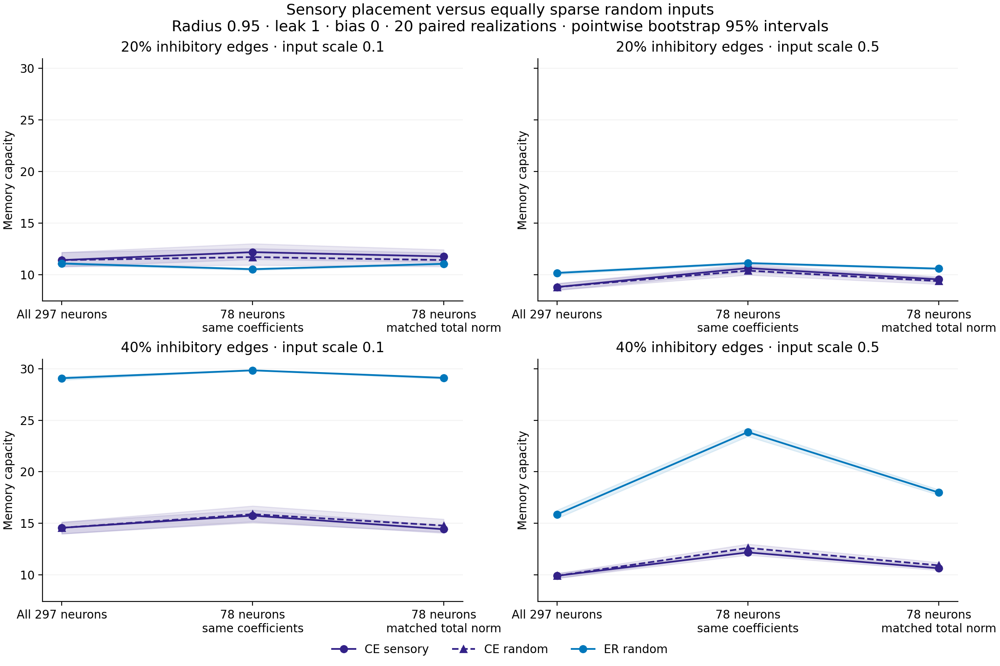
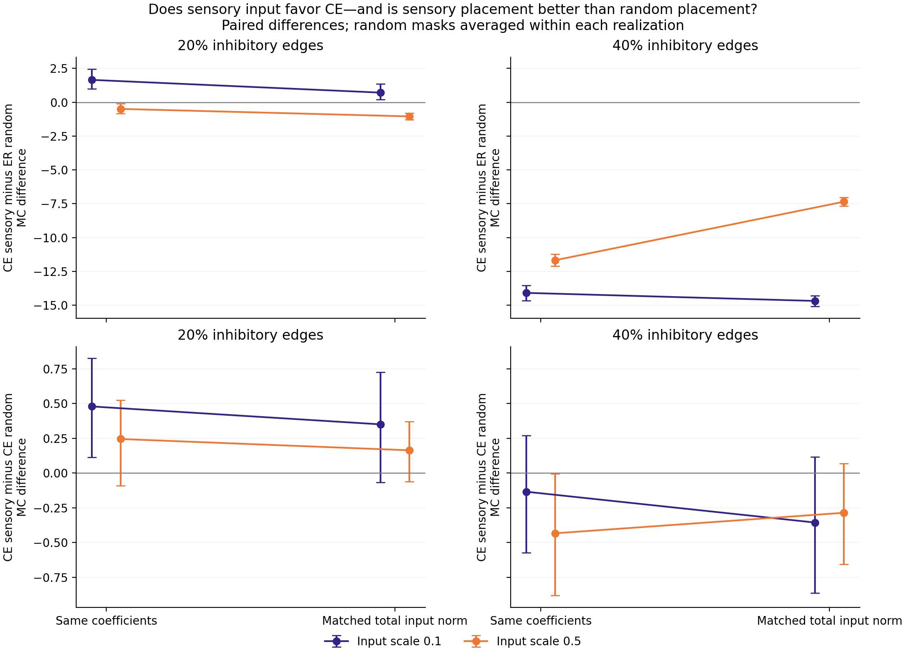
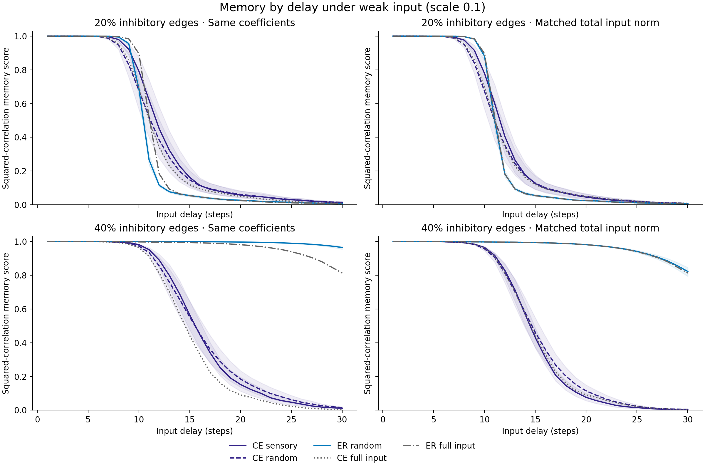

# Preliminary sensory-input experiment

**20 paired computational realizations; 1,280 MC evaluations.** CE receives one scalar input at 78 annotated sensory neurons; ER receives the same input at an equal number of randomly selected neurons. Three random input placements are tested per realization, together with equally sparse random placements on CE and full-input baselines for both architectures.

## Main findings

At **20% inhibitory edges and input scale 0.1**, CE sensory input exceeds ER random input by **+1.656 [+0.981, +2.462] MC** with unchanged input coefficients. The advantage remains **+0.714 [+0.191, +1.357] MC** when total input norm is matched to the full-input baseline.

The CE−ER difference increases from the full-input baseline even with total drive matched: **+0.388 [+0.159, +0.605] MC**. Thus reducing total drive is not the only change associated with the restricted-input advantage in this pilot.

Within CE, sensory placement exceeds equally sparse random placement by **+0.479 [+0.112, +0.825] MC** with unchanged coefficients. After matching total input norm, that difference is **+0.350 [-0.068, +0.727] MC**; its interval includes zero. A sensory-specific benefit independent of total-drive calibration is therefore not established.

The counterexamples are retained: **ER outperforms sensory-driven CE at 40% inhibitory edges and at input scale 0.5** under both calibrations. The results support conditional memory performance under restricted input, not a universal sparse-input advantage. They do not demonstrate that secondary eigenvalues cause the input-placement effect; the recurrent spectra were held fixed across placement conditions. At 40% and weak input, ER approaches the delay-30 MC ceiling, so its full memory capacity is not resolved by this protocol.

## Paired results

Positive values favor CE sensory input. Intervals are exploratory pointwise 95% bootstrap intervals over 20 paired realizations.

| Inhibitory edges | Input scale | Input calibration | CE sensory − ER random MC | CE sensory − CE random MC |
|---:|---:|---|---:|---:|
| 20% | 0.1 | Same coefficients | +1.656 [+0.981, +2.462] | +0.479 [+0.112, +0.825] |
| 20% | 0.1 | Matched total input norm | +0.714 [+0.191, +1.357] | +0.350 [-0.068, +0.727] |
| 20% | 0.5 | Same coefficients | -0.490 [-0.823, -0.113] | +0.245 [-0.091, +0.524] |
| 20% | 0.5 | Matched total input norm | -1.043 [-1.293, -0.791] | +0.163 [-0.062, +0.370] |
| 40% | 0.1 | Same coefficients | -14.088 [-14.672, -13.546] | -0.135 [-0.572, +0.271] |
| 40% | 0.1 | Matched total input norm | -14.684 [-15.077, -14.306] | -0.357 [-0.863, +0.117] |
| 40% | 0.5 | Same coefficients | -11.672 [-12.114, -11.217] | -0.434 [-0.883, -0.005] |
| 40% | 0.5 | Matched total input norm | -7.349 [-7.669, -7.036] | -0.286 [-0.658, +0.068] |





## Input calibration and controls

- **Same coefficients:** preserve the existing signed Gaussian coefficients at CE sensory entries. Move that exact ordered coefficient vector to each random CE/ER subset. Every sparse comparison therefore has the same number of driven nodes, coefficient values, signs and total norm. Relative to full input, this also reduces total drive.
- **Matched total input norm:** scale the same restricted coefficient vector so its L2 norm equals the original full-input vector. This holds summed expected input-drive power constant across dense and restricted inputs; individual driven neurons receive stronger input. It does not guarantee equal internal state amplitudes or saturation across architectures.
- **CE random control:** move the same coefficients to random CE nodes. This separates sensory placement from simply driving fewer nodes. Random subsets are uniform draws without replacement, may include sensory nodes, and are fixed across E/I fractions, scales and calibrations within realization.
- **Full input:** the usual Gaussian input vector drives all 297 neurons. The two architectures have exactly the same dense input weights in each realization. 40 existing 20%-EI, scale-0.1 full-input baselines were reused after exact checks of networks, input weights and stimulus sequences.

## Sensory annotation audit

The frozen [OpenWorm WormAtlas-derived neuron-type table](https://raw.githubusercontent.com/openworm/owmeta/945f7172f0dff1d022ce0574f3c630ee53297386/OpenWormData/aux_data/Modified%20celegans%20db%20dump.csv) supplies annotations. The selected rule includes labels beginning `Sensory neuron`, plus labels beginning `Polymodal neuron` that explicitly contain `sensory neuron`. It excludes motor-led/proprioceptive, putative motor/sensory, and interneuron-led labels. This is one conservative operational sensory set, not a claim that sensory function has a unique exhaustive classification.

This selects 80 annotated names; 78 map exactly onto the 297 matrix rows. Missing from this adjacency: **PLML, PLMR**. No neurons were inserted or indices guessed. The repository's legacy `old_cel.xls: Sensory` sheet is audited but is not the primary mask: it includes some neurons currently labeled interneurons and omits PVD. The exact mask, type strings and evidence URLs are in `sensory_neurons.csv`; every adjacency node is listed in `neuron_label_audit.csv`.

## Simulation and uncertainty

- Fractions 20% and 40%; input scales 0.1 and 0.5; own-radius target 0.95; leak 1; added bias 0. Recurrent matrices are unchanged between input conditions. CE restores unknown edges using the existing matched-sign construction; ER is the existing binary-weight sign-sweep control, not Gaussian ER. These comparisons still combine topology and recurrent-weight distribution.
- Reuses the repository's reservoir dynamics and MC readout: float32 states, float64 readout fitting; 500 washout, 1,500 training, 500 test steps; delays 1–30; ridge 1e-4 plus existing 1e-6 epsilon. All conditions share the same U[-1,1] stimulus within realization. Every readout is fitted to all 297 states. This is not a motor-neuron-only readout or a full biological sensory-to-motor model.
- One scalar signal is projected with signed Gaussian coefficients. It does not model sensory transduction, independent sensory channels or anatomical input synapse signs. No downstream task, noise robustness, spectral-mode intervention or input-sparsity sweep is included in this brief pilot.
- Base seed 20261117 + repeat_id×100000; existing network/unknown-sign/MC stimulus offsets retained. Random mask seed and all exact indices/coefficients are stored. Computational realizations are not independent animals.
- Three random masks are averaged within each realization for inference; bootstrap resamples complete paired realizations (5,000 percentile resamples, seed 20261118). Mask replicates are not counted as independent networks. All intervals are pointwise and not adjusted for multiple comparisons.



## Validation and files

All 1,280 scores are finite and within the MC bound; all 30 delay scores are present for every condition. Maximum relative error in matched total input norm: 1.30e-08. Sparse CE/ER inputs use identical coefficients and counts. Recurrent-matrix hashes are unchanged across all input placements. Five synthetic mask/annotation tests pass. All original data and preceding analyses are preserved.

`performance.csv` and `memory_curves.csv` retain every observation. `per_realization.csv` averages repeated random placements within realization. `summary_metrics.csv` and `paired_contrasts.csv` contain all estimates and uncertainty intervals. `manifest.json` records source/code hashes, frozen annotation commit, exact sensory indices and settings. Per-realization caches retain every actual input vector and recurrent matrix. Outputs are PNG, CSV, NPZ, JSON and Markdown; no PDFs.

```bash
python tools/run_sensory_input_pilot.py --n-repeats 20 --workers 4
python tools/analyze_sensory_input_pilot.py
```
