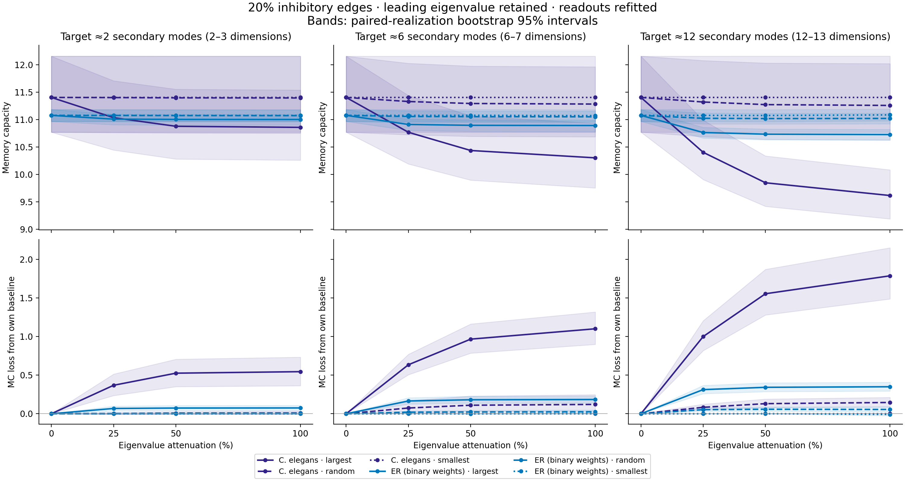
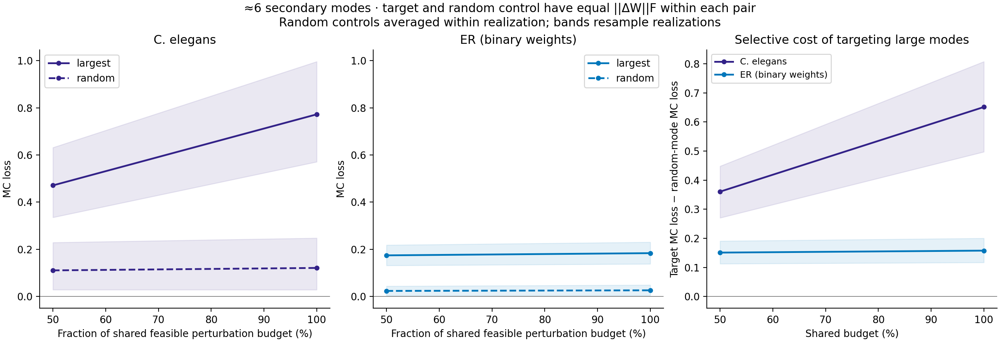
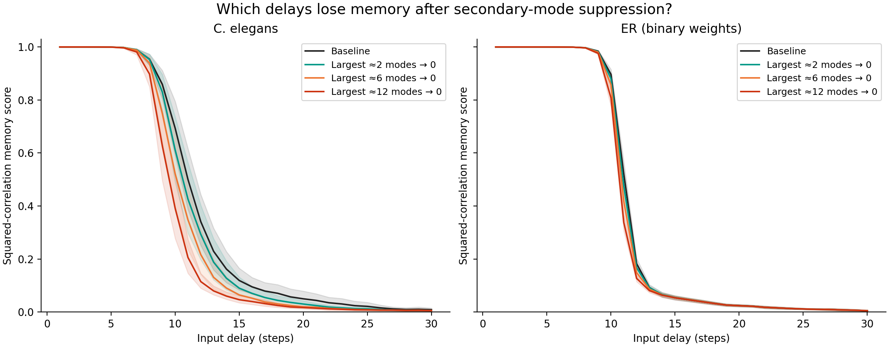
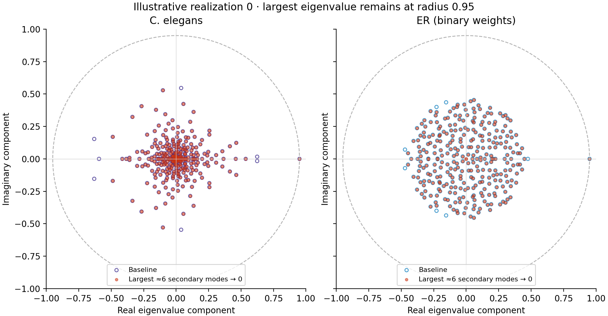

# Local spectral-mode intervention at 20% inhibitory edges

Completed 20 paired CPU realizations, 1,800 MC evaluations, and 54,000 delay scores. All readouts were refitted after each intervention. Existing results were preserved.

## Main results

Original mean MC: CE **11.403**, ER **11.076**. Paired CE−ER difference: **0.327 [-0.300, 1.084]** (pointwise bootstrap 95% interval). The paired baseline interval includes zero, so this 20-realization pilot does not establish a positive CE advantage by itself. It cannot demonstrate that an independently established advantage disappears.

The table below sets the selected secondary eigenvalues to zero while leaving the leading block unchanged. This shortens their persistence; it does not delete every transient pathway through those coordinates.

| Requested secondary dimensions | Model | MC after suppression | MC loss [95% interval] | Random-mode MC loss | Smaller-mode MC loss |
|---:|---|---:|---:|---:|---:|
| 2 | C. elegans | 10.857 | 0.546 [0.363, 0.734] | 0.010 | 0.000 |
| 2 | ER (binary weights) | 11.001 | 0.075 [0.039, 0.108] | 0.005 | 0.001 |
| 6 | C. elegans | 10.301 | 1.102 [0.899, 1.320] | 0.121 | 0.000 |
| 6 | ER (binary weights) | 10.891 | 0.185 [0.139, 0.232] | 0.026 | 0.004 |
| 12 | C. elegans | 9.614 | 1.789 [1.489, 2.153] | 0.146 | -0.000 |
| 12 | ER (binary weights) | 10.726 | 0.350 [0.294, 0.408] | 0.056 | -0.009 |

For ≈6 secondary dimensions, CE loses **0.917 [0.710, 1.145]** more MC than ER under complete attenuation. The resulting CE−ER MC difference is **-0.590 [-1.137, 0.025]**. These equal-fraction interventions have different weight-change sizes between architectures.



## Does the effect survive matching the size of the weight change?

For the ≈6-mode comparison, each target/random pair has the same actual number of dimensions, the same counts of real and conjugate-pair blocks, and the same Frobenius weight-change norm. Two random controls are averaged within each realization. The full feasible budget is the smaller of the two selected-block norms; both half and full budgets are tested. The attenuation multipliers consequently differ between target and control.

| Model | Target MC loss | Random MC loss | Target loss − random loss [95% interval] | Mean shared weight-change norm |
|---|---:|---:|---:|---:|
| C. elegans | 0.772 | 0.121 | 0.651 [0.497, 0.808] | 0.538 |
| ER (binary weights) | 0.184 | 0.026 | 0.158 [0.117, 0.200] | 0.805 |

Budgets are matched **within** each architecture/target/control pair. They are not identical across CE and ER, so their raw loss difference here is not a comparison at a common cross-architecture perturbation budget.



## Interpretation

- In C. elegans, targeting large secondary blocks costs more memory than random blocks even after matching weight-change size: 0.651 [0.497, 0.808]. This supports a contribution of the targeted persistence structure in this model intervention.
- In ER (binary weights), targeting large secondary blocks costs more memory than random blocks even after matching weight-change size: 0.158 [0.117, 0.200]. This supports a contribution of the targeted persistence structure in this model intervention.
- After ≈6-mode complete attenuation, mean MC retains 90.3% of its baseline in CE and 98.3% in ER. The intervention does not collapse memory; it does not support saying that a handful of modes do all the computational work.
- CE's loss is concentrated at later delays: delays 11–20 account for 0.687 [0.516, 0.877] MC loss, while delays 1–5 change by -0.000 [-0.000, 0.000]. This is consistent with shortening temporal persistence.
- This is evidence about the consequences of a specified weight-matrix intervention. It does not uniquely isolate eigenvalue magnitudes from changes to eigenvectors, transient interactions or nonlinear operating regime, and does not explain the entire E/I crossover.



## Methods and limits

- Pre-intervention sign fraction 20%; own-radius target 0.95; leak 1; input scale 0.1; added bias 0. CE restores unknown edges using the existing matched-sign construction. ER is the existing **binary-weight** sign-sweep control, not Gaussian ER. Both have 297 nodes and 3,604 original edges.
- The actual repository dynamics use `W.T @ state`. SciPy real Schur decomposition is applied to `A = W.T`; selected 1×1/2×2 diagonal blocks are multiplied by 0.75, 0.5 or 0. Off-block Schur entries are retained. No global renormalization follows. The leading block is excluded from all selections.
- Requested dimensions 2, 6 and 12 are reached or slightly exceeded to preserve conjugate pairs. Actual counts are in `interventions.csv`; all controls match the target's actual singleton/pair counts within each realization. Random selections may overlap target selections.
- MC reuses `network_stats.run_one.run_reservoir_states` and `network_stats.stats.compute_MC`: float32 dynamics, float64 readout fits, 500 washout, 1,500 training, 500 test steps, delays 1–30, ridge 1e-4 plus existing 1e-6 epsilon. Same input stream and input weights are used for every intervention within a realization. There is no selection on test scores and no new benchmark implementation.
- Base seed 20261117 + repeat_id×100000; the existing network, unknown-sign and MC-input offsets are retained. All baselines are rerun on CPU. CPU and CUDA input-weight draws can differ at the same seed, so these scores are not exact reproductions of the earlier GPU observations.
- Bootstrap: 5,000 paired-realization resamples, percentile 95% intervals, seed 20261118. Random-control draws are averaged within realization; configurations and perturbations are not treated as independent networks. Intervals are exploratory and pointwise, without multiplicity adjustment.
- Reconstruction generally creates dense connections and changes edge signs. **20% refers to the original networks**; the modified matrices do not preserve topology or inhibitory-edge fraction. This is a mechanistic model diagnostic, not a biological sign-preserving intervention.
- One E/I fraction, one hyperparameter combination, one input stream per realization, and 20 realizations limit generality. The Schur intervention depends on its chosen basis and retains nonnormal off-block couplings; zero eigenvalues can still support transient memory.



## Validation and reproducibility

All 1,800 scores are finite and within the MC bounds. Maximum leading-radius change: 2.55e-08. Maximum target/control Frobenius mismatch: 1.91e-08. Six synthetic intervention tests and six existing bootstrap/analysis tests pass. Source matrices are hashed and checked for changes; exact settings, package versions and code hashes are in `manifest.json`. `VALIDATION.json` records numerical checks. Per-realization baseline matrices, input weights, inputs and Schur decompositions are cached for reconstruction.

```bash
python tools/run_spectral_memory_pilot.py --n-repeats 20 --workers 4
python tools/analyze_spectral_memory_pilot.py
```

Outputs: `interventions.csv`, `memory_curves.csv`, `summary_metrics.csv`, `paired_contrasts.csv`, `delay_band_losses.csv`, four PNG figures, provenance JSON and per-realization caches. Existing completed realization files are reused only when the run manifest matches. No PDFs are generated.
