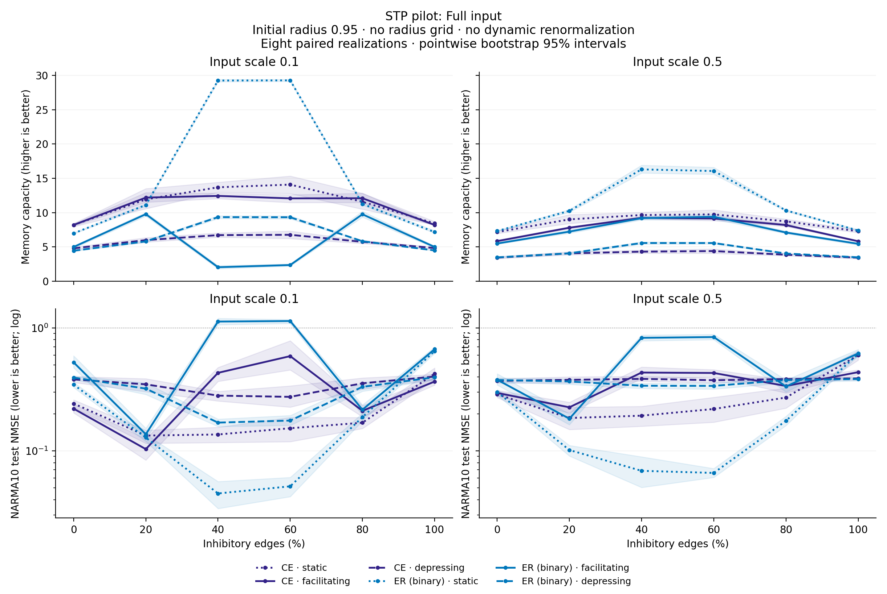
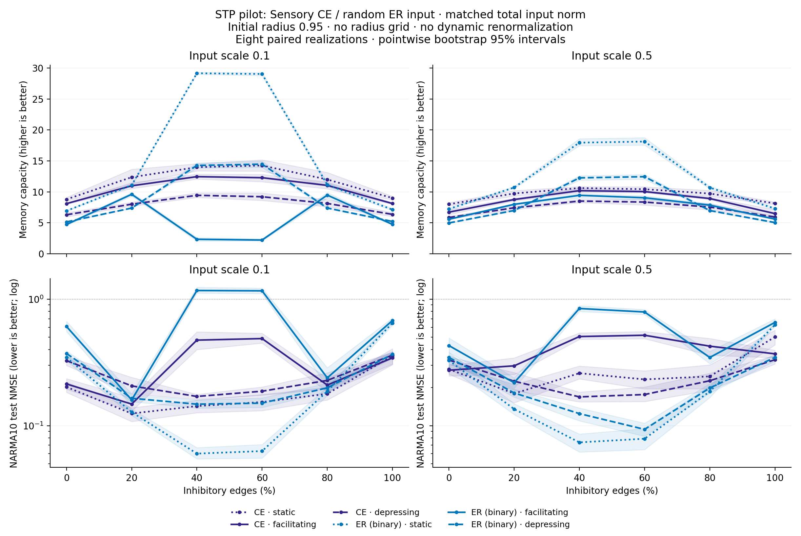
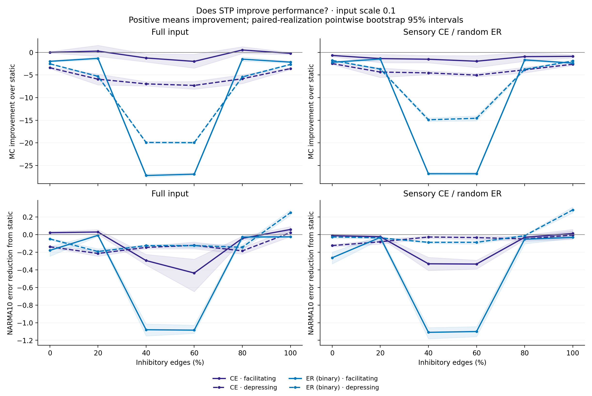
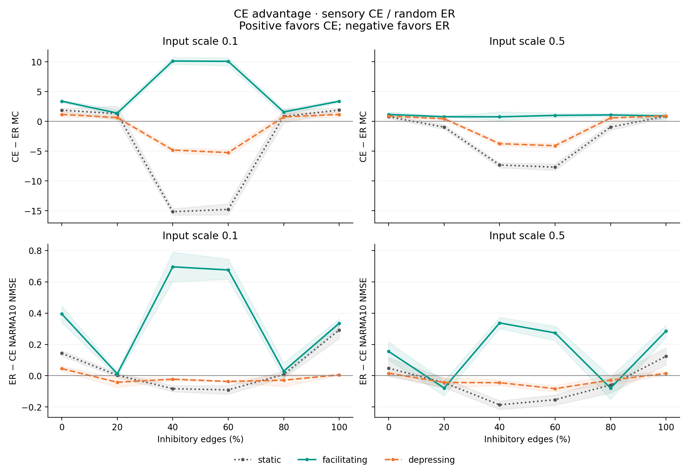
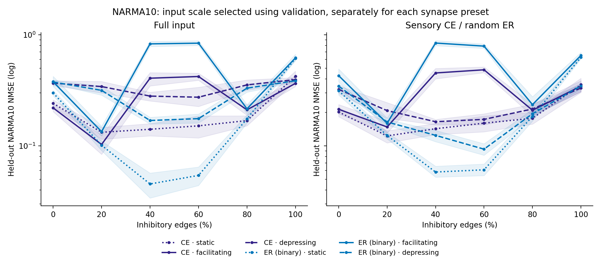
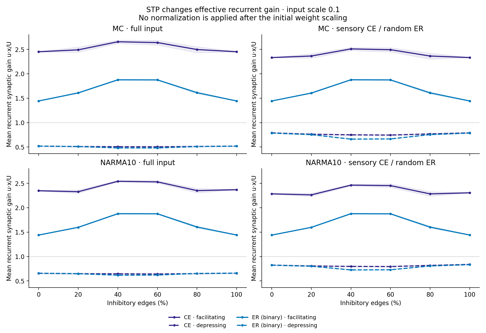

# Local STP pilot: MC and NARMA10 across 0–100% inhibitory edges

**8 paired CPU realizations; 1,152 MC/NARMA10 condition pairs.** Fractions 0, 20, 40, 60, 80 and 100%; input scales 0.1 and 0.5; full input and sensory CE/random ER input with matched total input norm. Static, facilitation-dominant and depression-dominant synapses are compared on the same base networks and signals.

## Spectral radius is not a grid parameter

There is **one initial own-radius scaling to 0.95**, inherited from the preceding local pilots. There is no radius sweep. STP is then allowed to change the recurrent coupling freely: no per-step or post-STP spectral normalization, gain clipping or parameter optimization. The initial normalization still differs by architecture/EI condition, so this is not an unnormalized or fixed-reference-scaling experiment.

## Main findings

- At 20% inhibitory edges, scale 0.1 and full input, facilitation changes CE MC by +0.265 [-0.897, +1.541]; its interval includes zero. CE NARMA10 error falls by +0.030 [+0.002, +0.056]. ER MC falls by 1.338, so a wider CE advantage partly reflects ER deterioration.
- With sensory CE/random ER input, the same facilitation preset reduces CE MC by 1.387 and increases CE NARMA10 error by 0.023. STP therefore does not consistently improve the connectome-derived reservoir.
- At 40% inhibitory edges with weak full input, facilitation changes MC from 13.69 to 12.43 in CE and from 29.25 to 2.04 in ER. Both deteriorate, especially ER. NARMA10 also deteriorates in both. The apparent reversal in architecture ranking here is not a CE performance improvement.
- Depression generally reduces MC in this parameterization. NARMA10 effects depend on E/I fraction and input strength. These are two generic parameter presets, not a search for each architecture's best STP regime.

## Results at 20% inhibitory edges and weak input (0.1)

Higher MC and lower NARMA10 NMSE are better. These are means of eight computational realizations, not optimized architecture scores.

| Input | Synapses | CE MC | ER MC | CE NARMA10 NMSE | ER NARMA10 NMSE |
|---|---|---:|---:|---:|---:|
| Full | static | 11.919 | 11.108 | 0.1329 | 0.1280 |
| Full | facilitating | 12.184 | 9.770 | 0.1031 | 0.1362 |
| Full | depressing | 5.985 | 5.802 | 0.3470 | 0.3201 |
| Sensory/random | static | 12.363 | 11.081 | 0.1247 | 0.1280 |
| Sensory/random | facilitating | 10.976 | 9.602 | 0.1481 | 0.1598 |
| Sensory/random | depressing | 8.001 | 7.378 | 0.2061 | 0.1646 |

## Does STP help each architecture?

At 20% inhibitory edges, scale 0.1, sensory/random input. Positive means improvement relative to the paired static control. Intervals are pointwise 95% bootstrap intervals; no multiplicity correction.

| Architecture | STP preset | MC improvement [95% interval] | NARMA10 error reduction [95% interval] |
|---|---|---:|---:|
| CE | facilitating | -1.387 [-2.295, -0.445] | -0.023 [-0.037, -0.008] |
| CE | depressing | -4.362 [-5.560, -3.453] | -0.081 [-0.109, -0.055] |
| ER (binary) | facilitating | -1.479 [-1.822, -1.163] | -0.032 [-0.055, -0.010] |
| ER (binary) | depressing | -3.703 [-3.864, -3.534] | -0.037 [-0.043, -0.031] |

## Full sweep figures









## Validation-selected input scale for NARMA10

Input scale is selected from 0.1 and 0.5 using validation NMSE separately for each realization, family, EI fraction, input scheme and synapse preset. The untouched test score is reported. Synapse presets are kept separate; neither test scores nor cross-preset test minima select models. The limited two-value input search is not an estimate of unrestricted optimal performance.



A second comparison lets each architecture choose among **all six tested input-scale/synapse-preset combinations** using validation. This retains the static control as an eligible choice, so an architecture is not forced to use a harmful plasticity preset. Positive differences below mean lower CE test error.

| EI | Input arrangement | CE test NMSE | ER test NMSE | ER − CE error [95% interval] |
|---:|---|---:|---:|---:|
| 0% | Full | 0.2194 | 0.3072 | +0.088 [+0.063, +0.109] |
| 0% | Sensory/random | 0.2051 | 0.3123 | +0.107 [+0.076, +0.139] |
| 20% | Full | 0.1059 | 0.1039 | -0.002 [-0.028, +0.022] |
| 20% | Sensory/random | 0.1232 | 0.1241 | +0.001 [-0.012, +0.015] |
| 40% | Full | 0.1412 | 0.0454 | -0.096 [-0.111, -0.080] |
| 40% | Sensory/random | 0.1438 | 0.0582 | -0.086 [-0.103, -0.067] |
| 60% | Full | 0.1516 | 0.0543 | -0.097 [-0.138, -0.060] |
| 60% | Sensory/random | 0.1490 | 0.0609 | -0.088 [-0.113, -0.064] |
| 80% | Full | 0.1679 | 0.1761 | +0.008 [-0.008, +0.026] |
| 80% | Sensory/random | 0.1779 | 0.1881 | +0.010 [-0.016, +0.037] |
| 100% | Full | 0.3863 | 0.3864 | +0.000 [-0.023, +0.025] |
| 100% | Sensory/random | 0.3085 | 0.3478 | +0.039 [-0.002, +0.078] |

At 20% with full input, letting both architectures select among all tested presets gives CE test NMSE 0.1059 and ER 0.1039, with CE advantage -0.002 [-0.028, +0.022]. The interval includes zero. The advantage seen when both are forced to use facilitation does not establish a best-tested CE advantage at this fraction.

## STP model and its scope

Published rate-based Tsodyks–Markram/Mongillo equations are used, as in [Masse et al.](https://pmc.ncbi.nlm.nih.gov/articles/PMC7321806/) and [Carvalho and Buonomano](https://pmc.ncbi.nlm.nih.gov/articles/PMC3105243/):

```text
du/dt = (U-u)/tau_f + U*(1-u)*r
dx/dt = (1-x)/tau_d - u*x*r
r = abs(previous signed tanh activity)
recurrent transmitted activity = (u*x/U) * previous activity
```

- One utilization/resource pair per presynaptic neuron modulates all its outgoing recurrent connections. All synapses in a preset share parameters. Synaptic signs and zero connections are preserved. Plasticity does not apply to the external input or readout connections.
- Facilitation-dominant preset: U=0.15, tau_f=75, tau_d=5. Depression-dominant: U=0.45, tau_f=5, tau_d=75. The U values and relative time-constant contrasts follow the [Norse demonstration](https://norse.github.io/notebooks/stp_example.html), with time constants expressed in input-sample steps. They are generic exploratory settings, not measured worm parameters or calibrated milliseconds.
- STP starts at recovered rest, u=U and x=1, separately for each task/condition. Dividing by U matches resting recurrent gain to the static matrix. Absolute tanh activity is a nonnegative release-rate proxy; signed tanh activity itself is retained for transmission. This is an explicit graded-activity adapter, not a claim that signed tanh states are biological firing rates.
- There was no rate-compatible STP implementation in the repository. The small published-ODE adapter is compiled with Numba; RK4 at four substeps per input sample is independently checked against SciPy solve_ivp. Existing spike-driven package implementations were inspected but were not substituted directly into signed graded dynamics. MC code and NARMA10 generation/readout are reused.
- All state variables are reset before each MC and NARMA10 trajectory. Only neuron activity is available to the linear readout, not the extra synaptic utilization/resource states. STP therefore changes the hidden dynamical system without adding readout features.



STP changes mean recurrent gain as well as adding history-dependent synaptic states. Without a matched static-gain control, performance changes cannot be attributed exclusively to synaptic memory. The saved last-step effective recurrent radii describe diag(gain)W, not the complete neuron-plus-STP Jacobian, and are not stability criteria.

## Benchmark protocol, uncertainty and limits

- Same CE unknown-sign completion and binary matched-ER sign-sweep control as the previous experiments. Each has 297 nodes and 3,604 original edges. This still varies topology and recurrent-weight distribution together; no Gaussian-weight ER control is introduced.
- Leak is fixed at 1 and bias at 0. Input is either the original dense Gaussian projection or the 78-neuron sensory CE / random ER mask from the preceding sensory pilot. Restricted inputs are scaled to the full input vector's total L2 norm. One random ER mask per realization is fixed across all fractions, input scales and synapse presets. Exact coefficients, node indices and labels are cached.
- MC: existing compute_MC, delays 1–30, ridge 1e-4 plus existing epsilon 1e-6, float64 readout, 500 washout, 1,500 training, 500 test steps. Reservoir activity is float32. MC is truncated at 30; near-ceiling scores do not resolve unrestricted memory capacity.
- NARMA10: **ReservoirPy 0.4.2**, with the unchanged generator and lag alignment of the original crossover runner. Target burn-in 1,000; reservoir washout 500; training 1,500, validation 500, test 500. Existing sklearn Ridge with intercept; alpha chosen on validation from 1e-8, 1e-6, 1e-4, 1e-2 and 1; no refit on validation and no output feedback. No local NARMA recurrence was written.
- The same input/target sequences, initial network and input projection are paired across static/STP conditions. MC uses U[-1,1]; NARMA10 uses its package-defined nonnegative input and nonzero mean, so the two tasks can induce different STP operating regimes.
- Eight computational realizations of one connectome; base seed 20261117 plus repeat_id×100000. Bootstrap resamples whole paired realization panels, 5,000 percentile resamples. Intervals are exploratory, pointwise and not corrected for multiple comparisons. This sample is too small to locate a crossover precisely or establish biological optimization.

## Validation and reproduction

All 1,152 condition pairs have finite scores; MC and per-delay scores obey their bounds. All conditions and 30 MC delays are present. NRMSE squared matches NMSE. STP resource/utilization states remain in [0,1] without clipping, base recurrent matrices are unchanged across input and plasticity conditions, and all input norms are matched as specified. Six synthetic STP tests pass. A static smoke check reproduced the previous local MC score exactly; doubling STP integration resolution changed MC by 1.24e-5 in the checked CE condition.

```bash
env PYTHONPATH=/tmp/cel-crossover-deps:. OPENBLAS_NUM_THREADS=1 OMP_NUM_THREADS=1 MKL_NUM_THREADS=1 \
  python tools/run_stp_mc_narma_pilot.py --n-repeats 8 --workers 4
python tools/analyze_stp_mc_narma_pilot.py
```

`performance.csv`, `memory_curves.csv`, `summary_metrics.csv`, `stp_effects.csv`, `ce_er_advantages.csv`, `validation_selected_configurations.csv`, and `validation_selected_narma.csv` retain all results. `manifest.json` records exact model/settings, source/code hashes and package versions; per-realization caches store stimuli, targets, networks, input weights and terminal gains. PNG figures only; existing results are preserved.
