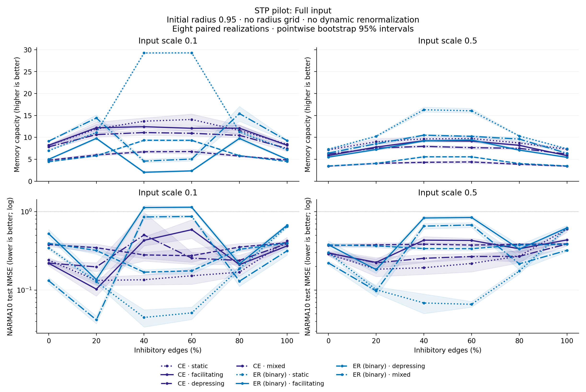
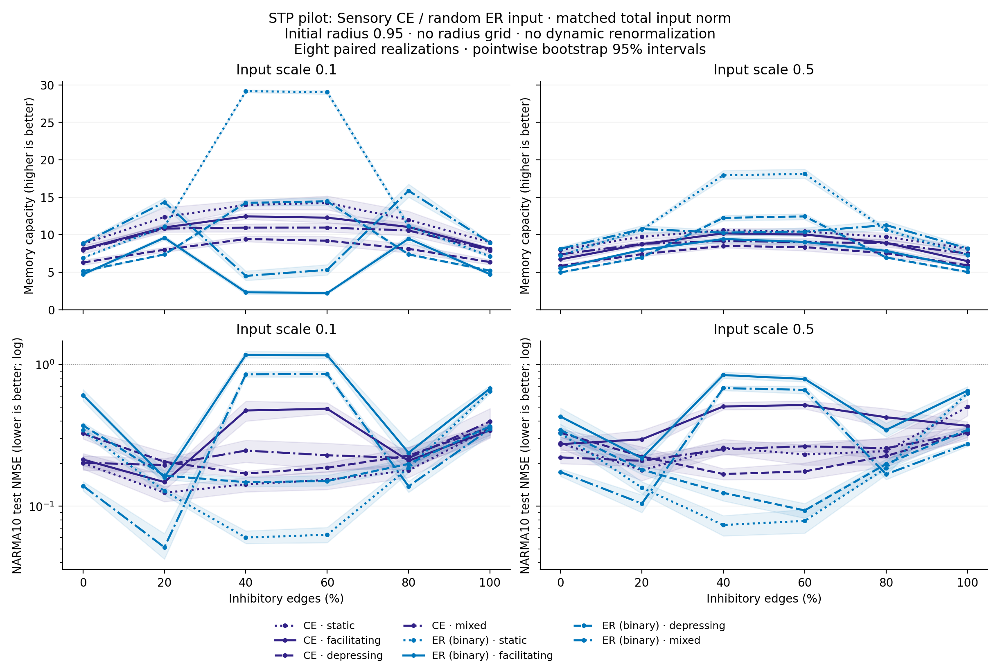
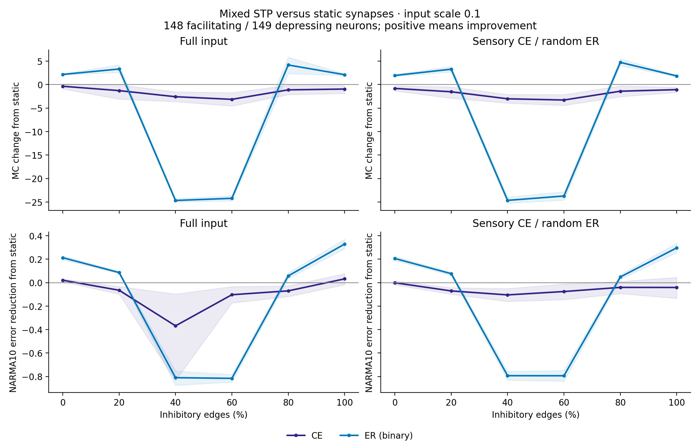
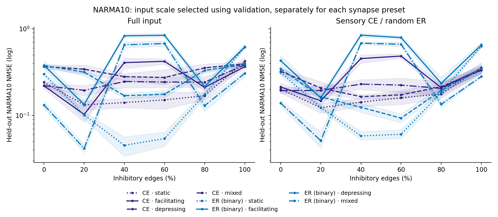

# Mixed facilitating/depressing STP: local MC/NARMA10 follow-up

Added **148 facilitating and 149 depressing presynaptic neurons** to each reservoir. The assignment is randomized per realization, shared by CE and ER at the same node indices, independent of edge signs, and held fixed across EI fractions, input strengths, input arrangements and tasks. Each neuron's outgoing connections use its assigned preset.

**384 new MC/NARMA condition pairs** were run across eight paired realizations. All 1152 preceding static/facilitating/depressing condition pairs were reused exactly. No spectral-radius grid was added: the same initial radius 0.95 is retained, and there is no dynamic renormalization.

The two earlier presets already contain both utilization and resource-depletion dynamics. The new condition mixes the two preset types within the same network rather than adding a second process to an otherwise one-process synapse.

## Main preliminary result

At 20% inhibitory edges and input scale 0.1, the mixed condition favors ER on both MC and NARMA10, with full input and with sensory/random input. Compared with the paired static controls, ER improves on both tasks while CE deteriorates. Thus the CE advantage under the homogeneous facilitating preset does not persist under this mixed assignment.

Around 40–60%, CE remains ahead of mixed ER under weak drive, but ER also deteriorates sharply relative to its static control there. The full sweep and paired changes retain these counterexamples. No general CE or ER superiority follows from this eight-realization, one-mixture-fraction pilot.

## At 20% inhibitory edges and weak input (0.1)

| Input arrangement | Synapses | CE MC | ER MC | CE NARMA10 NMSE | ER NARMA10 NMSE |
|---|---|---:|---:|---:|---:|
| Full | static | 11.919 | 11.108 | 0.1329 | 0.1280 |
| Full | facilitating | 12.184 | 9.770 | 0.1031 | 0.1362 |
| Full | depressing | 5.985 | 5.802 | 0.3470 | 0.3201 |
| Full | mixed | 10.627 | 14.415 | 0.1976 | 0.0418 |
| Sensory/random | static | 12.363 | 11.081 | 0.1247 | 0.1280 |
| Sensory/random | facilitating | 10.976 | 9.602 | 0.1481 | 0.1598 |
| Sensory/random | depressing | 8.001 | 7.378 | 0.2061 | 0.1646 |
| Sensory/random | mixed | 10.822 | 14.351 | 0.1952 | 0.0513 |

## Does the mixed condition improve each architecture?

At 20% and input scale 0.1, positive values indicate improvement relative to each realization's static control. Intervals are paired-realization bootstrap 95% intervals, exploratory and uncorrected for multiplicity.

| Input | Model | MC improvement [95% interval] | NARMA10 error reduction [95% interval] |
|---|---|---:|---:|
| Full | CE | -1.292 [-3.096, -0.060] | -0.065 [-0.098, -0.033] |
| Full | ER (binary) | +3.307 [+2.587, +4.167] | +0.086 [+0.077, +0.096] |
| Sensory/random | CE | -1.540 [-2.917, -0.509] | -0.070 [-0.099, -0.043] |
| Sensory/random | ER (binary) | +3.270 [+2.670, +3.865] | +0.077 [+0.062, +0.090] |

## Full sweep







## Validation-selected NARMA10

Input scale is selected from 0.1 and 0.5 using validation, separately for each synapse condition. The second selection analysis allows each architecture to choose among all eight input-scale/synapse combinations (static plus three STP conditions), again using validation only. Test outcomes do not choose models.

| EI | Input | CE test NMSE | ER test NMSE | CE advantage [95% interval] |
|---:|---|---:|---:|---:|
| 0% | Full | 0.2160 | 0.1321 | -0.084 [-0.094, -0.072] |
| 0% | Sensory/random | 0.1888 | 0.1393 | -0.049 [-0.069, -0.032] |
| 20% | Full | 0.1059 | 0.0418 | -0.064 [-0.084, -0.045] |
| 20% | Sensory/random | 0.1285 | 0.0513 | -0.077 [-0.094, -0.058] |
| 40% | Full | 0.1412 | 0.0454 | -0.096 [-0.111, -0.080] |
| 40% | Sensory/random | 0.1438 | 0.0582 | -0.086 [-0.103, -0.067] |
| 60% | Full | 0.1464 | 0.0543 | -0.092 [-0.130, -0.059] |
| 60% | Sensory/random | 0.1453 | 0.0609 | -0.084 [-0.108, -0.063] |
| 80% | Full | 0.1653 | 0.1334 | -0.032 [-0.062, +0.002] |
| 80% | Sensory/random | 0.1625 | 0.1349 | -0.028 [-0.055, -0.007] |
| 100% | Full | 0.3765 | 0.3065 | -0.070 [-0.107, -0.038] |
| 100% | Sensory/random | 0.3057 | 0.2820 | -0.024 [-0.046, +0.000] |



## Model and interpretation

- Identical rate-based STP equations, four RK4 substeps, absolute tanh-activity rate proxy, recovered-rest initialization and gain normalization u*x/U as the previous pilot. Facilitation preset: U=0.15, tau_f=75, tau_d=5; depression preset: U=0.45, tau_f=5, tau_d=75. Time constants are in model steps and are not fitted worm physiology.
- A neuron receives one preset; it retains both resource and utilization dynamics. Both excitatory and inhibitory edges can be facilitating or depressing. Assignment is not linked to neuron function or inhibitory-edge percentage. Approximately half the neurons are assigned each type; fractions of affected edges and absolute recurrent weight need not be exactly half, especially for heterogeneous CE. Those fractions are saved per condition.
- Reuses the original cached recurrent matrices, exact input coefficients, stimuli and ReservoirPy 0.4.2 NARMA10 targets. The readout pipeline is unchanged: MC delays 1–30, float64 ridge fitting, and NARMA ridge chosen using validation with an untouched test segment. No benchmark generator was rewritten and no original conditions were rerun.
- Both full input and 78-neuron sensory CE/random ER input are retained. Restricted input matches the dense vector's total L2 norm. Input scales 0.1 and 0.5, six fractions 0–100%, unit leak and zero added bias remain fixed as in the preceding pilot.
- The mixed assignment is one random draw per computational realization. Eight seed clusters jointly vary network/sign realization and mixed assignment; this design does not estimate assignment variability separately. These are not eight independent animals.
- STP changes mean gain as well as adding history dependence. A larger CE–ER gap need not mean that CE itself improved; use the paired effects table and static controls. No matched static-gain control or biological calibration is included.

## Validation and provenance

Four mixed-backend tests pass, including **bitwise equality** with the original simulation when all neurons use one preset. Silence, resets, balanced reproducible assignment and bounded resource variables are checked. All original condition values are retained exactly, all mixed task scores are finite, all 30 MC delays are present, and original source/result hashes are unchanged. Old outputs remain in their original directory.

All estimates and intervals are in `summary_metrics.csv`, `stp_effects.csv`, `ce_er_advantages.csv` and the validation-selection tables. `mixed_assignment.csv` records each neuron's type in every realization; `mixed_assignment_by_ei_sign.csv` audits independence from edge signs. `manifest.json` hashes the reused datasets and simulation code. New caches store exact assignments and terminal STP states. The original pilot report supplies the full inherited protocol. PNG only; no PDFs.

```bash
python tools/run_mixed_stp_mc_narma_pilot.py --workers 4
python tools/analyze_mixed_stp_mc_narma_pilot.py
```
