# Architecture and scientific interfaces

The main pipeline is:

```mermaid
flowchart LR
    A[Spreadsheets / processed connectome] --> B[Connectome preprocessing]
    B --> C[Topology and weight controls]
    C --> D[Spectral normalization]
    D --> E[Reservoir dynamics]
    E --> F[MC / IPC / KR / GR]
    F --> G[Provenance-tagged CSV rows]
    G --> H[Repeat grouping and grid summaries]
    H --> I[Tables and manuscript figures]
```



## Module boundaries

`cel_res_hypr.connectome` owns processed adjacency/name loading and unknown-sign
assignment. `networks.topology` owns directed graph generation/swaps;
`networks.weights` owns empirical sampling, interpolation, and sign controls;
`networks.normalization` owns eigensolver-based radius scaling and diagnostics.
`networks.builder.build_reservoir` composes them and creates input weights.

`network_stats.dynamics` implements the update; `network_stats.streams` generates
rank ensembles. `stats_util` supplies Legendre polynomials, squared correlation,
ridge readouts, and effective rank. `stats` defines metrics; `run_one` coordinates
a complete evaluation. These modules retain their original public import paths.

`experiments.config` contains `SimulationParams` and `VariantContext`.
`experiments.sampling` contains production grids, partitioning, and disjoint
node selection. `experiments.variants` dispatches named controls;
`experiments.evaluation` builds/evaluates each hyperparameter row and diagnostics.
`experiments.csv_io` owns schema and selective rank updates.

`analysis.aggregation` computes group-level means/dispersion. Plotting modules
separate input policies, styles, comparisons, tables, rendering, and figure
families. `graph_hist.py` retains its CLI orchestration and historical mutable
`ANALYSIS_MODE_FILTER`; private helpers imported by existing figure scripts are
explicitly reexported. `reservoir_variants`, `util.util`, and `util.graph_utils`
also retain compatibility exports. These facades contain no duplicate scientific
implementations.

## Core interfaces and shapes

| Interface | Inputs | Output |
|---|---|---|
| `load_connectome` | Adjacency/EI paths (EI may be empty) | Float32 `[N,N]`, optional `[N]` EI labels, optional name map |
| `build_reservoir` | Control, seed, adjacency, normalization, input scale | `W [N,N]`, `Win [N,1]`, optional radius diagnostics |
| `run_reservoir_with_pre` | `W`, `Win`, `u [T,I]`, leak, optional bias `[N]` | States and preactivations `[T,N]` |
| `run_reservoir_states` | Same trajectory inputs | States `[T,N]`, buffers matching `W.dtype` |
| `run_reservoir_stream_batch` | Streams `[S,T,I]`, initial state `[N]` | Final states `[S,N]` |
| `compute_MC` | Train/test states and scalar inputs; delay bound; ridge | Total and float32 per-delay capacities |
| `compute_IPC` | Same plus Legendre orders and threshold | Scalar restricted IPC |
| `compute_KR`, `compute_GR` | Final states `[S,N_observed]` | Centered Shannon effective rank |
| `run_variant` | Key and `VariantContext` | Tuples in `CSV_HEADER` order |
| `save_rows` | Path, rows, full/append/rank-only mode | Stable-schema CSV |

`W[i,j]` means source `i` to target `j`. Starting from zero, the scalar-stream
update is:

```text
pre[t] = W.T @ z[t-1] + Win @ u[t] + bias
z[t]   = (1-leak) * z[t-1] + leak * tanh(pre[t])
```

The batched form uses `z @ W + u @ Win.T + bias`. Bias is sampled uniformly
from `[-bias_range, bias_range]` with a dedicated seed. Input/output node subsets
are disjoint, sampled once per repeat and shared across architectures. Input
subsetting masks the existing input weights without rescaling; output subsetting
selects observed state columns. The legacy preactivation path assumes the
default float32 tensor dtype; its float64 limitation is preserved and tested.
The three dynamics paths intentionally retain separate loops for preactivation
tracking, dtype-preserving trajectories, and batched final states. Combining
them would risk changing allocation, dtype, and floating-point evaluation order.

## Network controls and normalization

Local-sign controls preserve the empirical edge signs while changing magnitudes
to absolute Gaussian, uniform, empirical sign-specific samples, or unit values.
Global-sign controls randomize negative-edge placement while preserving its
count. Weight shuffles permute signed nonzero weights; directed topology swaps
preserve in/out degrees and transport edge weights. Swaps are limited by the
historical failed-attempt budget and do not claim uniform graph sampling.
Synthetic ER/WS-like controls match the connectome edge count. Sign-fraction
controls specify a negative-edge fraction, rather than flipping that fraction
of existing signs. These are edge controls, not Dale-law constraints on neurons.

`run_variant` accepts numeric suffixes as labels for sign/weight sweeps. The
actual numerical parameters are `ctx.per_neg` and `ctx.alpha`; suffixes are not
parsed as parameter values. Three-value legacy grid tuples imply zero bias;
four-value tuples are `(rho_target, leak, input_scale, bias_range)`.

```text
spectral_radius: W_scaled = W * target / rho(W)
original_radius: W_scaled = W * target / rho(W_family_reference)
```

Radii are computed with `torch.linalg.eigvals`; the legacy function name
`spectral_radius_power` does not denote power iteration. Radii below `1e-9`
leave the scale at one. In own-radius mode, `target=None` leaves weights
unchanged; in original-radius mode it means target one. Family references are
empirical, signed-unit, or unsigned-unit matrices as appropriate. ER sign
sweeps construct a paired reference using the same sign permutation at the
empirical negative-edge fraction. Diagnostics record `raw_rho`, `ref_rho`,
`post_rho`, and `scale_factor`; the achieved radius may differ from the target
in original-radius mode.

## Capacity and rank definitions

MC trains a linear readout for each delay `d=1..D` on `Xtrain[d:]` against
`utrain[:-d]`, then scores the separately aligned test segment. Scores are
squared Pearson correlations and are accumulated in float32. The readout fits
no intercept. Both targets and predictions are centered for scoring; constant
signals have zero correlation capacity.

IPC sums the same correlation score for `P_k(u[t-d])` over configured Legendre
orders and delays. It includes no mixed-delay products and is therefore a
restricted IPC calculation. Orders for a given delay are solved together:

```text
(Xtrain.T @ Xtrain + (alpha + 1e-6) * I) @ readout = Xtrain.T @ targets
prediction = Xtest @ readout
```

The solver is `torch.linalg.solve`, with no explicit inverse or Cholesky step.
Targets below the configured score threshold are omitted. Production defaults
are washout 500, training 1500, testing 500, delays 30, orders `[1,2,3,4,5]`, and
ridge alpha `1e-4`.

KR uses 300 independent uniform `[-1,1]` streams of length ten. GR uses 300
streams with independent seven-step prefixes and one common three-step tail.
Each stream resets to zero; one final state is retained per stream. Dedicated
KR/GR generators isolate these ensembles from training input generation.
For either ensemble, center every observed neuron over streams, obtain singular
values `s`, retain `s > 1e-12`, and compute:

```text
p = s / sum(s)
effective_rank = exp(-sum(p * log(p)))
```

Singular values are square roots of Gram-matrix eigenvalues. The probability
weights use singular values, not their squares. Exactly zero centered states
return zero. Decimal float32 constants can leave centering residuals above the
absolute cutoff; this historical behavior is retained. The `_pilati` functions
remain available as separate uncentered relative-threshold rank definitions;
they are not the production Shannon-rank functions.

The GR sensitivity workflow fixes the seven-step prefix and extends/truncates
one shared continuation. Its reference tail length three exactly matches the
production stream generator for a given seed. Total length is `7 + tail_length`;
length zero is a prefix-only diagnostic.

## CSV and statistical contracts

The 20 raw CSV fields, in order, are:

```text
mode,normalization,shuffle_id,rho_target,leak,input_scale,neuron_bias,
MC,IPC,KR,GR,wt_mean,cosine_similarity,kl_to_gaussian,seed,src,
raw_rho,ref_rho,post_rho,scale_factor
```

`shuffle_id` is the repeat identifier, including for non-shuffled controls.
Rank-update identity includes mode, normalization, repeat, four grid values,
seed, and source. Rank-only updates preserve existing MC/IPC; KR-only updates
also preserve GR. New rank-only rows leave uncomputed metrics blank. Existing
rank updates require exact schema agreement and atomically replace the file.
Full writes and appends retain the historical caller-created-directory contract.

Aggregation groups by `(mode, src, group_id)`, first averages duplicate grid
points, then calculates means and population CV `std(ddof=0)/(abs(mean)+1e-12)`.
For legacy rows with `shuffle_id=-1`, complete repeat blocks are inferred within
mode/source using the number of distinct hyperparameter tuples. If a block
cannot be inferred, the existing source-level grouping is retained. Preserve
row order when relying on that fallback. Normalization is not an independent
aggregation key: analyze separate normalizations separately or retain the CLI's
normalization suffixes in mode labels.

The plotting column policy trims mode names and retains extra columns; the
merge policy drops obsolete `wt_mag_cv` and preserves existing mode whitespace.
They remain distinct intentionally. Exact CV, grid-averaging, and output-path
helpers are shared. Methodology scripts retain specialized per-order/delay
calculations because their protocols/output schemas differ from production.
Figure families likewise retain local histogram/smoothing/axis calculations
where layouts and normalization policies differ. Those expressions were kept
verbatim during extraction and checked through representative artifact equality;
a generalized rendering abstraction would require broader figure validation.

See [AUDIT.md](AUDIT.md) and [CRITIC_REPORT.md](CRITIC_REPORT.md) for known
historical limitations and the evidence supporting this separation.
